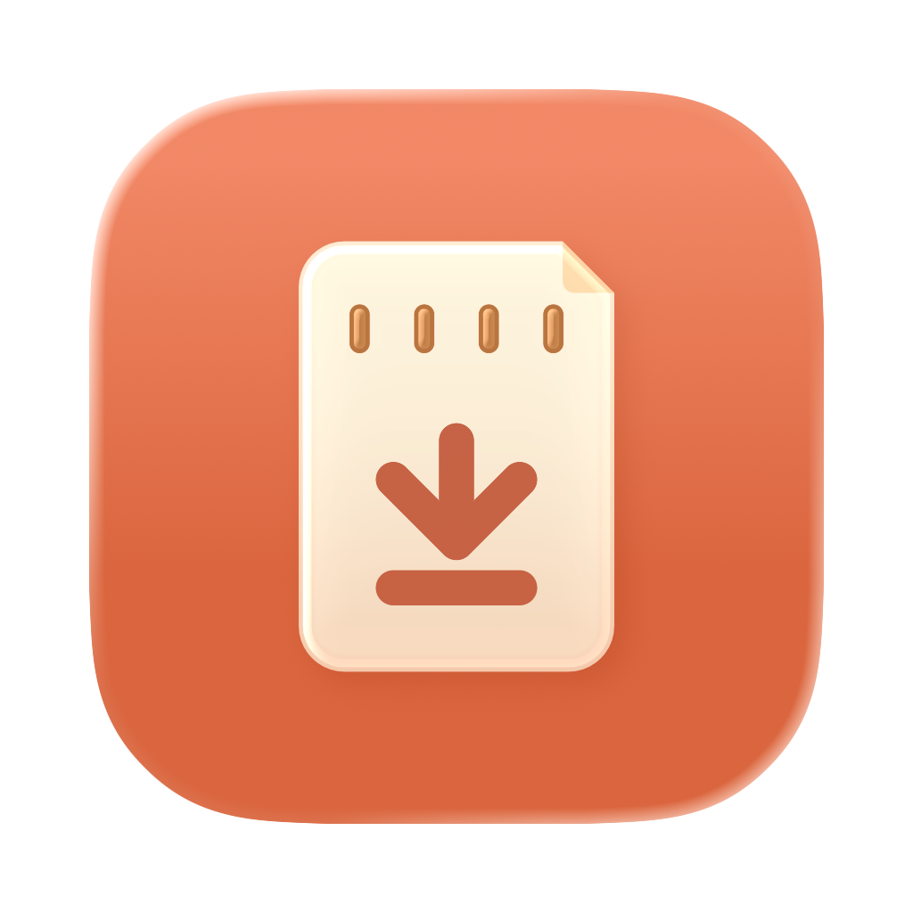

# Automatic Photo Importer

A React + TypeScript desktop app, hosted by Electron with a portable Node filesystem backend, that watches for camera media, copies originals to a chosen drive or folder, and organizes them using capture dates and camera metadata.



## What it does

- Detects mounted SD/CFexpress cards, camera card readers and cameras in USB mass-storage mode. Also supports USB camera catalogs exposed by Apple's ImageCaptureCore.
- Imports into `photobackup/{year}/{yyyymm}/{camera}` by default. In Settings, the folder builder puts the date first or the camera first. Year, month and day folders switch on or off independently. A month folder can be `10` or `202610`, or in English `10 October` or `2026-10 October`. A day folder can be `20` or `20261020`. The file-type layout comes last, and **Advanced: custom template** keeps the free-text template (tokens `{year}`, `{yyyymm}`, `{month}`, `{monthName}`, `{yearMonthName}`, `{day}`, `{yyyyMMdd}`, `{camera}`).
- Reads camera names from original RAW metadata and preserves the camera's recorded calendar date across timezone boundaries.
- Offers six media layouts inside the camera folder: photos and videos each split by format (`Photos/NEF`, `Videos/MOV`), a folder per format (`NEF`, `JPEG`, `MOV`), photos together with videos in `Videos`, videos together with photos in `Photos`, everything together (the default), or videos in a separate video backup folder (default `videobackup`) beside the photo backup folder, with the photo template or their own. Format folders use the uppercase extension with spellings merged (JPG/JPEG → `JPEG`, HEIC/HIF → `HEIF`, TIF → `TIFF`, MPG → `MPEG`). Sidecars and metadata stay with their file: XMP/DOP/AAE with the photo, Sony XML, DJI LRF and audio with the video, and `NKSC_PARAM` beside the NEF. Edited exports stay directly in the edited folder. Camera imports include associated companions, including Sony video XML, and ignore unrelated camera index files such as `NIKON001.DSC`. Unknown extensions can be ignored or sent to a chosen relative folder, with optional remembered rules.
- Verifies file contents using SHA-256 and skips identical copies. Different files with the same name go to a stable `Conflicts/<content-id>/` folder inside the camera folder, preserving the original filenames and companions. Authenticated interrupted imports resume after checking source identity and the already-written prefix; unrelated or legacy partials are preserved.
- Provides a custom import desk with large Start/Stop controls, Automatic mode, a visible queue, source/destination capacity bars, a saved one-column list or responsive two-column source grid, and a persistent 1–5 concurrent-source slider (default 2). Continuous capacity strips use separate colors for individual formats such as NEF, ARW, JPG, PNG, MP4 and MOV; details retain format counts and sizes.
- Scans sources without copying files. Each row shows the full source path, physical capacity, photo/video totals, and counts and sizes for actual extensions such as NEF, ARW, JPG and MP4. Metadata analysis then identifies multiple camera models on one card; drive-name, format and layout hints remain separate from confirmed metadata.
- Supports one destination, verified copies on two distinct disks, or filling the first disk before continuing on the second. Neither copy mode propagates source deletions.
- Backs up a selected drive/folder with its original folder structure, including non-photo user files.
- Provides photo previews, detailed EXIF fields and metadata-derived shutter counts with provenance. Video files can expose metadata; video playback previews are not implemented.
- Previews organization of existing files across the selected destination, then verifies new files before retaining originals in a hidden recovery store. Interrupted operations can be rechecked and resumed.
- Offers English, 简体中文, 繁體中文 and 日本語 in Settings, with System/Light/Dark appearance and adjustable text size. Settings centralizes destination and folder configuration. Navigation, dialogs, disclosures and buttons provide motion with reduced-motion support. Format choices and metadata-read problems appear in the dedicated All errors panel.

Camera cards cannot be selected as backup destinations. Local folders and nonremovable external hard drives/SSDs are supported. The conservative destination policy also blocks removable USB flash drives. Turn on **Enable media folder selection** to choose an ordinary drive or folder for manual import.

## Build and run

The active desktop app uses Node.js and npm. Install dependencies, then build and launch:

```sh
npm ci
npm start
```

Useful development commands:

```sh
npm run build       # Typecheck and bundle the renderer and Electron process
npm run typecheck   # TypeScript checks only
npm test            # Backend and platform tests
npm run native:mac  # Build the macOS ImageCaptureCore camera helper (requires Xcode tools)
npm run package:mac # Build helper and app, then package a local macOS arm64 app
```

Build the native helper before using USB camera catalogs on macOS. The packaged desktop app is written under `build/desktop`. These are local development builds, not notarized distribution releases. Windows and Linux share the frontend and filesystem backend and have `package:win` and `package:linux` targets; those binaries are not claimed as built or hardware-tested here. Native camera-protocol support is currently macOS-only.

For a quick, isolated Codex integration run:

```sh
npm run codex:test
npm run codex:test -- --no-build # Repeat against the existing build
npm run codex:test -- --no-build --ui-only # UI checks without organization or bulk transfers
npm run codex:test -- --no-build --organization-only # Organization/recovery and UI checks, no bulk transfers
npm run codex:qa                # Leave a visible fixture app open for UI inspection
```

See [Codex testing](docs/codex-testing.md) for coverage, retained screenshots and reports, and the interactive QA workflow.

On first launch, choose the backup drive or folder, then a relative backup path (default `photobackup`). Leave that path empty to use the selected folder directly. Keep the app running to detect new media. Use **Start imports**, **Stop** and **Automatic** in the title bar. Press **Start imports** to queue connected sources even when **Automatic** is off. **Stop** clears the queue and cancels active work; completed files remain. Automatic mode handles new camera connections. Camera-card imports ignore unrelated file types even when a manual folder rule exists; associated photo/video sidecars remain included. **Scan media** and **Scan all** only read source files. **Review** builds a plan that you can inspect before applying; automatic jobs copy after verification planning. Lowering the parallel-source limit lets current jobs finish before starting more.

Select a review row to inspect that file's photo and metadata; the separate **Preview photo** picker was removed as requested. Metadata and previews use bundled ExifTool. Capture date, time and recorded timezone appear separately; lens and exposure settings have a compact summary, with full tags collapsed until expanded. Videos omit shutter counts and currently have no playback preview. Shutter counts are reported only when supported metadata provides them; missing or unsupported values remain unavailable.

The shared title bar holds the page title, **Start imports**, **Stop**, **Automatic**, **Total progress** and **All errors**; ⌘/Ctrl+R refreshes sources. macOS uses native close, minimize and fullscreen controls in its title bar. The workbench remains shared across platforms.

Open **Settings** to choose English, 简体中文, 繁體中文 or 日本語, **System**, **Light** or **Dark** appearance, an accent color and text size. Automatic mode, the parallel-source limit and manual source selection have one control location on the Import desk. System is the default and follows OS appearance changes while the app is open. The text size slider ranges from 100% to 150%, defaults to 125%, and saves your preference.

## Drive backups and two disks

Use **Back up drives or folders…** (several can be chosen at once) for an every-file backup that preserves original relative folders instead of applying camera/date sorting. Hidden user files are included; symbolic links, non-regular entries, AppleDouble and filesystem service files are skipped. Empty directories, hard-link topology and complete filesystem attributes are not replicated. Each source drive gets its own folder under `Drive backups/` on the destination. In **Additive** mode, destination-only files remain, and different contents with the same filename are retained with safe collision names. In **Mirror** mode, files that are no longer on the source drive (or whose contents changed) are listed in Review. Applying the review moves them into `Drive backups/.mirror-removed/<date>/`; nothing is deleted. Mirror cannot be combined with **Fill first, then second**.

**Copy to both destinations** requires two distinct physical disks and reports incomplete copies if either copy fails. **Fill first, then second** routes complete media/companion families according to available space. Both are copy-only policies; neither is RAID parity or deletion synchronization.

See [scanner research and measured timings](docs/scan-performance.md) and [integration verification](docs/verification.md). See [shared desktop implementation](docs/multiplatform-migration.md) for platform adapters and validation limits.

## Scan sources before importing

Use **Scan media** on a source, or **Scan all**, to inspect mounted cards and manually selected folders without creating a copy job. A progress bar follows each step that checks files before anything is written: a scan's listing, measured against a drive's used space or, for a folder, against what its last scan found; import and organization reviews; and the automatic backup folder check. Source cards use a compact stack: identity, status, actions and capacity stay visible. Open **Drive details** on any card to see its full selectable path, format counts and camera metadata; each card starts collapsed and expands independently. Media totals count photos and videos only; documents, other files and companions do not inflate those totals, even during an every-file backup.

The fast inventory appears first. Read-only EXIF analysis then checks the media files and shows each confirmed camera model with its file count and byte total. One card can contain several cameras. A volume name, vendor-specific RAW extension or camera-specific folder layout is shown only as a hint; missing metadata remains unknown. Direct USB camera catalogs need to download files before inspection, so use **Review** for those sources.

## Existing libraries

In **Organization**, choose the backup folder, folder template and media layout, then select **Organize existing files…**. The preview scans recognized media and companions across the **whole selected destination**, including old backup folders. It compares each existing path with the proposed path beneath the current backup folder. Choose the first or second destination for this operation; your import copy policy, including **Copy to both destinations**, stays unchanged. After you change the media layout, organizing moves existing backup files into it. With a separate video backup folder, videos move from the photo backup folder to the video one and photos move the other way; the automatic backup folder check compares both folders once an import has created the video folder. Organizing a chosen folder in place needs a layout without a separate video folder. Switching from a separate video folder back to another layout leaves the videos already in the video folder where they are.

Set **Edited exports folder** (default `editied`) to keep editor-exported photos under each month separately from originals. RAW and their XMP remain together. Apply the reviewed organization to write and SHA-256-verify the new files. Verified duplicate source locations also move into recovery; only empty obsolete directories are removed, and different-content collisions retain both files. Originals then move into a hidden recovery store on the same filesystem. The interface does not automatically clean them up; the separate maintenance finalization API can release retained duplicates only after rechecking and synchronizing every target. **Organization recovery** lists saved operations; use a row’s **Resume & recheck** or **Recheck** to validate contents and continue. The first Recheck in a session reads every file. Later ones read only files whose size or dates changed since; on exFAT and FAT drives that is a size-and-date check. **Full recheck** reads everything again, and releasing or undoing always reads contents first. Rechecking a record from an older version also converts its one-file-per-event journal into one log, so it lists in seconds afterwards. **Refresh list** updates the list without hashing every media file.

Recovery uses the operation’s saved paths. Changing folder settings requires a new review. Read [Organization and recovery](docs/organization-recovery.md) for storage locations, the private host key, interruption handling and recovery limits. Normal imports leave camera and source-drive originals in place.

Stopping an import leaves completed files intact. Review or import the source again to recheck actual contents and continue. Original content is preserved on name collisions; a filename alone does not establish a verified duplicate.

## Compatibility

Mounted mass-storage devices use normal filesystem access. PTP/MTP support depends on the camera catalog exposed by macOS; proprietary Wi-Fi and unsupported vendor modes are not claimed. RAW metadata and previews depend on available ExifTool and format support. Missing metadata is visible in the import preview and uses explicit fallback naming.

Camera-protocol transfers stage on the Mac before copying to the backup destination, so temporary local space is required. Filesystem copies are verified against source contents; protocol downloads can be checked against reported size but may not expose a camera-side checksum.

The app icon was created and verified in Apple Icon Composer. Its editable `Icon.icon` and compatible `Icon.icns` are included. See [icon build instructions](docs/icon.md), [research and prior art](docs/research.md), and [implementation notes](docs/implementation-plan.md).

## Architecture and actual feature coverage

See [实际功能、接口与架构审查](docs/architecture-and-features.md) for every production interface, data flow, fixes, validation and known feature gaps. UI labels and dynamic backend messages (job progress, results, history and common errors) support four languages; rare low-level errors keep their original English text. Mirror drive backups move removed files aside rather than deleting them; two-destination copying is a separate copy policy, not a mirror.

The product has one Electron entry point and one Node planning/copy implementation. The superseded SwiftUI app was removed; only the macOS ImageCaptureCore camera bridge remains native (see [historical implementation](docs/legacy-implementation.md)).
