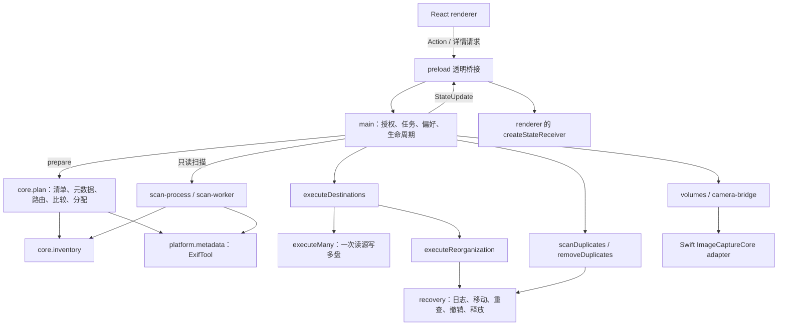
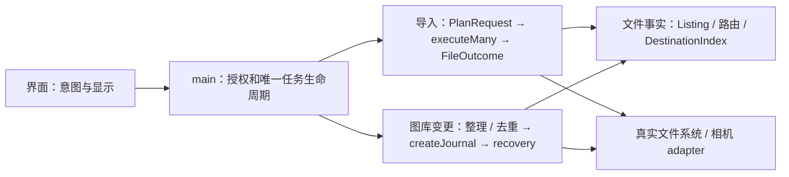

# 实际功能、接口与架构审查

审查日期：2026-10-23；第一次基线 `daaabd8`。**第 12 节为 2026-10-29 复审与修复（基于 `d89394f`），与前文冲突处以第 12 节为准。** 第 1–11 节按 `main@6b3dcff` 更新：第 3–7、9–11 节描述的是修复后的代码；R1–R13 的原始发现与处理结果见第 7 节。修复按 [修复计划](superpowers/plans/2026-10-23-architecture-remediation.md) 第 9 节（任务 A1–A17）执行，旧轮次的结论仍可从 Git 历史查阅。

**结论：一个功能一个实现。** 修复后：任务只有一条生命周期；实际文件结果只有一个出口，去重、落位记忆和删除原件都消费它；内容摘要只归 `DestinationIndex`；目录规则、名称校验、同名处理、目录清理、日志建立、错误身份、剩余时间、元数据解释各只有一处实现。没有新增通用 manager、repository 或 event bus。

运行时间、吞吐和内存没有做规模化实测；文中只记录已测的回归项（见第 10 节）。

## 1. 第一性原理与判定规则

应用最终只需完成四件事：发现来源与目的盘；把源文件映射为明确的目标；执行复制或整理并确认结果；把结果交给界面。一个功能只有一个权威 implementation；同一功能的不同按钮应汇入同一条实现。

采用 Matt 的术语：module 是提供 interface 的实现集合；interface 包括类型、时序、错误和信任条件；depth 是调用者通过小 interface 得到的能力；seam 是行为替换位置；adapter 处理真实环境差异；locality 指规则和修改集中在同一处。

判定不看文件长短，而看：

- 删除一个 module 后，复杂度直接消失，还是重新散落到调用者？前者可以删；后者原来承担了职责。
- 同一事实是否有两个维护者，例如同一文件的 SHA-256 在两个记录中采用不同失效规则？
- 同一批数据是否经过序列化、复制、全表筛选后，调用者只取其中一小部分？
- 是否为尚不存在的第二个实现设计 interface？测试替身可以留在 implementation 内部，不必变成产品选项。
- 产品配置与重复实现分开判断。六种目录布局现在共用一个路由实现；它们不是六套复制引擎。是否删掉布局选项，需要产品选择，不能从源码自行推断用户不要某一项。
- 校验、恢复日志与真实文件系统能力差异有明确作用；不把它们统称“兜底”后删除。相反，吞错后标记成功、重复重试、未使用的结果字段应直接收敛。

未发现 `GLOSSARY.md` 或 `docs/adr/`，本轮没有新增术语体系或决策流程。

## 2. 当前实际架构

这不是“每一层都重复传文件内容”：媒体字节在文件系统复制、哈希线程、相机暂存路径流动；renderer 接收的是清单、计划、状态和按需详情。必须区分两种成本。

核心链路：

- **媒体导入**：`action → enqueue → pump → startJob → run → prepare → plan(按意图的 PlanRequest) → executeDestinations → executeMany → stageMany/publish → FileOutcome → finishJob`。
- **预览**：`previewSource → prepare` 保存 `Prepared`；`applyReview → run` 使用同一计划，不由界面把 JSON 计划传回执行。
- **整理**：多个入口进入 `queueOrganization → prepare → executeReorganization → beginOrganization → createJournal → recovery.run`。
- **去重移除**：`scanDuplicates → resolveGroups → removeDuplicates → beginDuplicateRemoval → createJournal → recovery.run`。候选规则和移动执行是不同职责，共用恢复执行。
- **相机**：Swift 下载至临时文件夹，再进入同一个导入计划器；Swift 不是第二套归档实现。

## 3. 实际跨进程 interface：8 个方法

全局是 `window.importer`。`DesktopAPI` 有 **8 个方法**：7 个 invoke handler 加一个推送事件。写操作统一经 `action(Action)`；完成状态从订阅读取，`action()` 的 Promise 完成不等于后台任务完成，命令失败写入 `state.error`。所有 handler 先 `trusted(event)` 检查来源帧；读文件的还经过 `allowed()` 的已选路径授权。

| interface | 通道 | 唯一 implementation |
|---|---|---|
| `state()` | `importer:state` | `stateChannel.snapshot(state)`，自包含的 reset 快照 |
| `subscribe(listener)` | `importer:updated` | `emit → createStateChannel.publish`；renderer 的 `createStateReceiver` 解析引用表 |
| `action(Action)` | `importer:action` | `main.action` 的 50 个分支 |
| `thumbnail(path)` | `importer:thumbnail` | `thumbnailSlots → platform/thumbnails.thumbnail` |
| `summary(path)` | `importer:summary` | `metadata(path,{details:false})`：路由用的短标签及缓存，供摘要卡 |
| `exif(path)` | `importer:exif` | `metadata(path)`：全部标签，供 EXIF 面板。原 `inspect` 及其无人显示的内嵌预览已删除 |
| `duplicateGroups()` | `importer:duplicates` | 当前去重分组，按 revision 获取 |
| `errorPaths(jobId,code)` | `importer:errorPaths` | `job-issues.issuePaths`，按需取分组错误的全部路径 |

定义在 `shared.ts` 的 `DesktopAPI`；桥接在 `preload.ts`；注册在 `main.ts` 末尾。

### 原生辅助程序 interface

`camera-bridge.request` 经 stdin/stdout JSONL 发送带 id 的请求，只有 `list` 和 `stage {cameraID,directory}` 两个命令；返回 result/error/progress。取消 stage 会关闭整个 bridge，所有 pending 请求一起失败，不是单请求取消。相机正在 stage 时来源查询读缓存，避免排队阻塞。

同一个原生可执行文件另有独立 CLI `--set-file-times created modified`，通过继承的 FD 3 调用 macOS 文件时间操作，不接收目标路径；这是文件时间 adapter，不是第三个 JSONL 命令。见 [camera-bridge.ts:62](../desktop/platform/camera-bridge.ts#L62)、[main.swift:28](../Sources/CameraBridge/main.swift#L28)、[file-timestamps.ts:46](../desktop/platform/file-timestamps.ts#L46)。

## 4. Action 全量清单：50 个入口对应的实现

同一功能的多个按钮汇入一个 Action；只差参数的旧 Action 已合并（`scanSource/scanSources → scan`，`clearError/clearErrorIds/clearErrors → clearErrors`，恢复列表的 4 个 Action → `recovery{op}`，`organizeFolder/organizeSourceFolder → organizeFolder`，`skipFile/skipAndContinue → skip`）。

| 功能 | Action | 实际 implementation |
|---|---|---|
| 刷新设备和目的盘 | `refresh` | `main.refresh`：每次一份卷快照（`mountedVolumes`），路径到卷只经 `volumeOf` |
| 选择来源文件夹或整盘 / 勾选 / 忘记 / 重连提示 / 置顶 | `chooseSource`、`selectSource`、`forgetDevice`、`dismissReconnected`、`moveToTop` | `resolveFolderSources`、`DeviceSelection`（只记住卷 UUID 或 `camera:` id）、`queue-order.moveToFront` |
| 选择 / 移除目的地 | `chooseDestination`、`removeDestination` | `validateDestination` |
| 只读扫描一个或全部已选来源 | `scan{sourceId?}` | `startScan → scan-worker → inventory/analyzeSourceCameras`；路由增量用 `beginRoutingCapture` |
| 开始 / 暂停 / 停止 / 重试 / 跳过 | `start`、`pause`、`stop{jobId?,scope?:'imports'}`、`retryJob`、`skip{jobId,path?,all?}` | `enqueue → pump → startJob → run → finishJob`；`stop-scope.ts` 决定“全部停止”与“只停导入”各停哪些工作；重试与跳过重入同一计划器 |
| 已知问题标为已处理 / 清除错误显示 | `acknowledgeErrors`、`clearErrors{ids?,severity?}` | `acknowledgeJob`；`error-log.clearErrors` |
| 审核导入或整理 / 改用文件日期 / 应用 / 丢弃 | `preview`、`previewOrganization`、`reviewFileDate`、`applyReview`、`discardReview` | `previewSource → prepare`；应用使用同一个 `Prepared`，审核后的整理与一键整理是同一种任务 |
| 整理目的地 / 文件夹 / 备份目录 | `organize`、`organizeFolder{sourceId?}`、`organizeBackup` | `queueOrganization → prepare → executeReorganization → beginOrganization → recovery` |
| 手动检查备份目录 / 停止检查 | `checkBackupFolder{destinationIndex}`、`stopBackupCheck` | 与自动检查同一个 `findMisplaced`（只读路由分支）；结果整理见 `misplaced-results.ts`；只有“全部停止”和停止检查本身会中止它 |
| 整理范围与本次选项 / 继续 | `chooseOrganizationFolders`、`resetOrganizationFolders`、`organizeOptions`、`continueOrganization` | `takeOrganizeOptions/sourcePolicy`（本次选项是唯一权威，排队或审核时冻结并重置） |
| 恢复列表与操作 | `refreshOrganization`、`recovery{op:'resume'\|'finalize'\|'undo'\|'delete'}`、`measureOrganizationRecovery` | `listOrganizations`；`resumeOrganizationJob(op)` |
| 删除已备份原件 | `measureOriginals`、`deleteOriginals` | `core/originals`：登记在 `originalsControls`，可停止、退出时等待、保持唤醒；停止后已删文件照样报告 |
| 移除重复项 | `duplicatesScope`、`duplicatesChooseFolder`、`duplicatesScan`、`duplicatesStop`、`duplicatesRemove` | `scanDuplicates`；`resolveGroups → removeDuplicates → beginDuplicateRemoval → recovery` |
| 清理残留 / 删除旧收据 / 确认旧记录 | `cleanResidue`、`removeReceipt`、`acknowledgeOldRecords` | `findResidue/cleanResidue`；`core/old-records.ts`（确认前拒绝整理与移除重复；转换器已删除，最后能转换的构建是 `records-migrator-v5`） |
| 设置 / 未知格式规则 | `preferences`、`unknownRule` | `acceptedPreferences(settingsLocked) → normalizePreferences → save`；目录设置保存时经 `checkFolderSettings` |
| 诊断日志 | `logOpenFolder`、`logCopyPath`、`logExport` | `log-export.exportLogs`：只导出 zip，失败写 `state.error` |
| 在访达中显示 / 窗口 | `reveal`、`window` | `allowed → shell.showItemInFolder`；BrowserWindow |

## 5. 核心功能与规则的唯一归属

### 5.1 发现、扫描、路由与复制

| 功能 | 核心 interface → implementation | 数据 / 约束 |
|---|---|---|
| 挂载卷发现、容量与物理盘识别 | `mountedVolumes/getSources/volumeInfo/volumeOf` → `platform/volumes.ts` | 三个 OS adapter；每次刷新一份快照（种类直接来自系统描述），路径到卷只经 `volumeOf`；新进程首次查卷只描述该路径所在的挂载；稳定 id 只用卷 UUID 或 `camera:` id |
| 文件夹来源合并及所属物理盘 | `resolveFolderSources` → `folder-sources.ts`；展示分组 → `drive-groups.ts` | 多个文件夹仍是独立 Source；共享一块盘时由路径最前的来源显示容量，不随置顶变化；同盘读并发受 device 规则控制 |
| macOS 协议相机 | `cameraSources/prepareCamera` → `platform/camera-bridge.ts` → Swift `DeviceDiscovery` | JSONL list/stage；下载暂存后进入文件系统计划；非 macOS 无 PTP implementation |
| 清单、系统文件、未知格式、空文件 | `inventory` → `core/inventory.ts` | `media-formats.ts` 是格式目录；`known-files.ts` 是系统文件识别。复用记录是 `Listing`（目录 key、名称、大小），不再伪造 Inventory；大小过期时只重读那个父目录 |
| 伴随文件与 Live Photo | `inventory` 的 `companionOf` + `pairLivePhotos` → `core/index.ts` | XMP/AAE/DOP、LRF/XML/音频、NKSC、ContentIdentifier 等；family 共同分配，不能拆盘。按名字模式配对的（Sony M01.XML/R01.BIM、IMG_O….AAE、GoPro/Insta360 LRV）也接受同名规则加的 ` (n)`，只与相同编号配对 |
| 相机/镜头汇总 | `analyzeSourceCameras` → `source-cameras.ts` | 元数据证据与盘名/目录提示分开；扫描新增路由结果回传 main |
| 路由元数据 / 完整详情 / 内嵌图片 | `metadata` → `platform/metadata.ts`，解释只经 `metadataFromTags` | 同一个 ExifTool；路由读短标签并缓存，EXIF 面板读全部标签；瞬间转换只用 `capture-time.captureTimestamp`；快门数为数字，由界面格式化；`embeddedPreview` 只供缩略图 |
| 日期、相机、编辑导出与目录布局 | `plan → folder/layoutFolder` → `core/index.ts`；token 与展开 → `folder-template.ts` | 六个 layout 是同一个路径函数的分支；设置预览调用同一套 token；落位与路由记忆共用 `routing-options.rulesScope`（含未知格式规则） |
| 缺日期 / 相机、未知格式目标 | 同一 `folder` / 计划器 | 缺失信息使用明确目录；不凭空补造 EXIF；自定义未知格式规则是产品配置。目录名只经 `validateRelative/validFolderName` 一套规则，导入与“设置”共用 `checkBackupFolders`，能保存的名字就能计划 |
| 目标已有内容比较、同名冲突 | `existingMatches/allocate/target` → `core/index.ts` | 同尺寸再确认 SHA。同名不同内容由偏好 `conflictNaming` 决定：`folder`（默认）放入 `Conflicts/<内容 id>/`，`number` 改名为 `name (n).ext`，整个 family 共用 n；已有相同内容的 ` (n)` 视为已备份 |
| 单盘 / 双盘副本 / 顺序填盘 | `fillFirst/allocateDestinations` → `core/allocation.ts` | 按 family 分配；顺序填盘先分盘再命名，第二盘只为第一盘放不下的 family 计划；盘 1 份额一选定即预留；每块物理卷一个预留键 |
| 容量预留与目的盘校验 | `prepare/availableFor` + `destinationRoots/validateDestination` | 卷身份、路径包含关系和并发任务预留；预览也持有预留 |
| 复制与发布 | `executeDestinations → executeMany → stageMany/publish`，exFAT 直写 `finishDirect` → `core/index.ts` | 同一源块写多个目标；目的盘失败隔离。每个目标在最终同步后发出一次 `FileOutcome`（实际路径、published/existing/routed、content-verified 或 stream-only）；去重记录、落位记忆、可删原件都只消费这一份 |
| 哈希 | `Hasher.update/digest/drop` → `core/hasher.ts`；文件读取 → `paths.digest` | worker 与本地计算同一 SHA 语义；复制时边读边 hash 与重新读取文件不是两套校验规则 |
| 中断续传 | 暂存/收据操作 → `core/import-recovery.ts` | 只复用已证明归属且身份一致的临时文件；不能把任意同名文件当作续传数据 |
| 整盘只增 / 镜像 | 目录归属、`mirrorChanges/moveMirrorRemovals` → `core/drive-backup.ts` | 普通用户文件保留目录；镜像差异需审核后移入 `.mirror-removed`，不直接传播删除 |
| 源文件失败与跳过 | `plan` 的 failure/exclude/skipErrors | 重试共用原计划器；镜像和协议相机有不同可跳过限制 |

### 5.2 整理、恢复、去重与清理

| 功能 | 唯一 implementation | 实际行为 |
|---|---|---|
| 整理已有图库 | `executeReorganization → beginOrganization → createJournal → recovery.run` | 计划绑定进程内审核身份；新日志一律 rename（无 strategy 的旧日志仍按 copy 读取）；整理与去重共用一个私有 `createJournal` |
| 异常媒体归集 | `plan` 的 problems + recovery | 空文件及其族、不可读文件按规则留原地或归入 Problem files，不混入正常照片目录 |
| 恢复继续 / 重查 | `resumeOrganization` | 根据日志确认已完成状态，再继续；full 明确要求重新读取全部内容 |
| 撤销 | `undoOrganization` | 把仍能证明归属的文件放回；识别后续整理的接管关系 |
| 释放原件 | `finalizeOrganization` | 确认目标副本后释放恢复存储，不等同撤销 |
| 恢复文件测量与删除 | `measureOrganizationRecovery/deleteOrganizationRecovery` | 结束/被取代日志、依赖关系、实际保留内容分别处理 |
| 文件夹错位检查 | `findMisplaced → planOnce` 的只路由分支 | 无第二套路径规则；off/ask/auto 只是检查/执行策略 |
| 去重扫描与候选分组 | `scanDuplicates` + `duplicate-rules.ts` | 摘要只经 `DestinationIndex`（可证明 stat），`DuplicateStore` 只存元数据；读取失败返回 `failures` 并显示未读数量，同次扫描每个文件只算一次摘要。级别为 1、2：自动处理只针对 SHA 相同的组，EXIF 组等用户确认 |
| 导入后去重记录 | `recordDuplicates` 消费 `FileOutcome` | 只记录本次实际发布的结果；计划与扫描用同一成员过滤（非 Other、大于 0 字节、非伴随文件） |
| 移除重复项与附属文件 | `removeDuplicates → beginDuplicateRemoval → recovery.run` | 审核决定保留者，确认身份/内容，处理伴随文件，保留撤销所需记录 |
| 删除已备份来源原件 | `core/originals.deleteOriginals` | 独立显式操作，仅文件夹导入提供；资格来自实际结果，且须覆盖分配要求的全部目标（镜像两盘、顺序填盘为所分配的盘）；删除前重读各目标，源在 APFS/HFS+ 且身份未变时不重读；停止不丢已删结果 |
| 目录清理 | `redundant-folders.removeEmptiedFolders`，由日志、删除原件与镜像移除调用 | 唯一实现：只删本次清空的目录，自下而上、同设备、不跟随链接；服务文件可删，`._` 仅当 `inspectAppleDouble` 判定只含记账信息；新日志签名记录清理范围 |
| AppleDouble 清理 | `AppleDoubleCleaner/inspectAppleDouble` | 判断 `._` 内容；不确定项保留并报告警告；不是任意删除所有隐藏文件 |
| 中断残留清理 | `findResidue/cleanResidue` | `resumable` 与 `kept` 分开计数；自动清理两者都保留；显式清理可处理更多残留 |

### 5.3 状态、显示、资源与持久化

| 功能 | implementation | 当前归属 |
|---|---|---|
| 偏好校验 / 默认值 / 旧设置迁移 | `preferences.normalizePreferences` | 读盘和更新共用；当前默认 parallel=5（范围 1–10）、字号 125%（范围 100–200%）、mediaLayout=video-root，以源码为准 |
| 本次整理源动作 | `run-policy.sourcePolicy` | 导入 copy；整理 rename；本次 OrganizeOptions 决定清目录/释放重复项 |
| 状态发送与接收 | `state-channel.createStateChannel/createStateReceiver` | 一个引用表：清单、任务错误与分组明细、问题文件、错误日志、历史、去重 earlier 列表、审核；按版本只在变化时发送 |
| 错误聚合、显示清除与按需路径 | `job-issues/error-groups/error-log/acknowledge` | 错误写入只经 `addErrors/recordIssue`，身份在记录时确定；错误日志缓存按真实变更版本重建，等长替换也会更新 |
| 四语言与消息 | `messages.ts` + `renderer/i18n.tsx` | 后端发 Message key/参数，前端翻译；部分原生/低层错误保留原文 |
| 导入页、来源详情、审核、组织、设置、历史 | `renderer/RootApp.tsx` 中具体界面函数 | 同一个 React 应用；list/grid 是展示配置，不改变复制逻辑 |
| 去重页 | `renderer/DuplicatesPage.tsx` + `renderer/duplicate-details.ts` | 详情按 root + revision 分代缓存，成功与在途分开，单项失败可显式重试；与主界面共用的组件在 `renderer/ui.tsx`、`renderer/progress.tsx`，两边不再互相导入 |
| 缩略图 | `platform/thumbnails.ts` | macOS 系统 decoder/视频海报，必要时提取内嵌图片；磁盘图片缓存；其它 OS 系统 decoder 返回不可用 |
| 启动画面、品牌与动画 | `Boot/boot-controller/BrandLogo/styles.css` | 纯呈现，不参与文件计划和执行 |
| 并发与物理盘 I/O | `pump`、`core/devices.ts`、`queue-order.ts` | 任务槽位与盘读写限制是两个不同约束；同盘目录来源不能当独立硬盘 |
| CPU/内存设置 | `resource-limits.ts`、`threadpool.ts` | 一个已保存上限的读取供线程池和偏好共用；界面写“上限”而非实测用量；内存是软预算，非进程总量硬上限 |
| 剩余时间 / 速率 / 历史先验 | `eta.ts/eta-model.ts/eta-priors.ts/eta-format.ts`、`rate-meter.ts` | 一个估计器 `JobModel`（列目录为显式估计总量步骤）；`job.eta` 存模型秒数；显示保持与分桶只在界面做一次（`useHeld`）；没有测量时显示不确定进度条 |
| 目录枚举进度提示 | `listing-estimate.ts/platform/listing-memory.ts` | 只用于估算，不决定复制是否正确 |
| 盘活动与防休眠 | `platform/drive-activity.ts/keep-awake.ts` | 主进程采样系统指标、任务期间保持唤醒 |
| 延后恢复列表刷新 | `deferred-refresh.ts` + main | 任务忙时推迟必要读取，避免与正在进行的 I/O 竞争 |
| 设置/历史、报告、恢复密钥 | `main.save/initializeRecoveryKey` 与各任务报告 | userData 设置/历史、operation-reports；恢复 manifest 在图库恢复目录 |

## 6. 数据流与重复成本

### 6.1 当前做法

1. 状态通道的一个引用表覆盖清单、任务错误与分组明细、问题文件、错误日志、历史、去重 earlier 列表和审核；只有版本变化的明细随更新发送，进度消息不再重复序列化不变的大字段。`Inventory.listing` 不发给 renderer。
2. 扫描子进程只回传本次新读到的路由条目（`beginRoutingCapture`，按秒 flush），main 按来源在 module 内筛选保存（`routingEntriesUnder`），不再整表复制后再找增量。
3. 多目的地仍是 `stageMany` 一次读源、写多个目标；各目标独立回读校验。实际结果每个目标发出一次，主进程按来源建一个 Map，完成阶段线性消费。
4. 单文件详情：摘要卡用 `summary` 的短标签，EXIF 面板用 `exif` 的全部标签，图片按需走 `thumbnail`；没有无人显示的预览经过 IPC。
5. 内容摘要只有 `DestinationIndex` 一份，信任条件为完整 stat（dev/ino/size/mtime/ctime，FAT/exFAT 的 `ctime==mtime` 不可证明）。

### 6.2 仍然存在、本轮有意保留的成本

| 数据 | 流向 | 判断 |
|---|---|---|
| 相机媒体内容 | 相机 → 本机暂存 → 目的盘 | 统一文件系统核心的 adapter 成本；不新增相机专用复制引擎 |
| 哈希块 | 主线程复制 chunk，再 transfer 给 hash worker | 换取主线程不做哈希；没有 profile 不改 |
| 其它 StateFields | 偏好、恢复列表、设备信息仍随更新发送 | 体积小；没有 IPC 体积测量前不改成通用 patch 协议 |
| EXIF 面板 | 第二次读取全部标签 | `RequestAll` 的必要成本；扫描不为界面读全部标签 |

缓存仍按用途区分：`scan-memory` 保存可重新验证的源清单与路由；导入记录保存已校验源摘要；`placement-memory` 只证明上次规则下“位置正确”；`listing-memory` 只是进度估算；`DestinationIndex` 是唯一可信摘要；`DuplicateStore` 只存去重用的元数据。

## 7. 原始发现与处理结果

第一次审查（基线 `daaabd8`）的 R1–R13 均已处理。下表列出最终做法和对应任务；原始证据与行号见 Git 历史中本文件的上一版本。

| 编号 | 原始问题 | 处理结果 | 任务 |
|---|---|---|---|
| R1 · P1 | 删除原件绕开任务生命周期，Stop 和退出管不到 | 登记在 `originalsControls`：可停止、退出时等待、计入空闲判断、保持唤醒、受设置锁约束；停止后已删文件照样报告，预检与目录清理阶段的停止都不抛异常 | R-T01 / review-4 |
| R2 · P1 | 去重 EXIF 读取失败被记成已读 | 只在成功时记录；失败进入 `failures` 并显示未读数量；同次扫描每个文件只算一次摘要 | A3 |
| R3 · P2 | 导入完成阶段二次方遍历 | 按来源一次建 Map | review-4、A2 |
| R4 · P2 | 为找扫描增量每秒复制整个路由缓存 | `beginRoutingCapture` 只记新读条目；`routingEntriesUnder` 在 module 内筛选 | A6 |
| R5 · P2 | `inspect` 与 `exif` 重复，且生成无人显示的预览 | 删除 `inspect` 与预览；文字详情分 `summary` / `exif` 两种真实需求 | review-4、A8 |
| R6 · P1 | 去重页“已请求”与“已有结果”状态混在一起 | `duplicate-details.ts`：按 root + revision 分代，成功与在途分开，失败可显式重试 | review-4、A11 |
| R7 · P2 | 进度更新携带不变的大明细 | 引用表加版本，只在变化时发送；错误日志缓存按真实变更版本重建 | review-4、A9 |
| R8 · P2 | 去重与目标索引重复拥有“文件是否可信” | 摘要只归 `DestinationIndex`；`DuplicateStore` 不再存 SHA，元数据缓存用同一 stat 谓词 | A3 |
| R9 · P2 | 持久偏好与本次整理选项存在假入口 | 删除失效的持久偏好及 `livePreferences`；本次选项是唯一权威 | review-4、A12 |
| R10 · P3 | 计划请求过宽 | `PlanRequest = ImportRequest \| DriveRequest \| OrganizeRequest`，另有只读的 `MisplacedRequest`；都走一个 `planOnce` | A15 |
| R11 · P2 | 无消费者的变体与公开整理策略 | 删除 `restore`、`mode:'recorded'`、持久分组；`strategy` 不再公开，新日志固定 rename；两种日志共用 `createJournal` | A3、A4 |
| R12 · P1 | 执行事实不集中返回，完成阶段用旧计划路径 | `onFileOutcome` 每个目标一次；去重、落位、可删原件只消费它；晚分配到 `Conflicts/` 的实际路径被如实记录；三套目录清理收为 `removeEmptiedFolders` 一套 | A2、A4 |
| R13 · P3 | ETA 与排队的无用状态 | 删除第二估计器与无读者状态；排序直接返回任务；显示保持只在界面一处 | review-4、A10 |

修复过程中另行发现并处理：顺序填盘第二盘把文件误放进 `Conflicts/`（A1）；`removeRedundantFolders` 的计数恒为 0（A4）；无 UUID 卷被两个任务各算一次空间（A2）；A7 新进程首次查卷做全系统扫描，使崩溃恢复测试慢 5 倍（集成时修复）；按名字模式配对的伴随文件在 ` (n)` 改名后不能再配对（A17 集成时修复）。

## 8. 应保留的深 module 与真实 adapter

| 对象 | 删除测试 / 保留理由 |
|---|---|
| `scan-process/scan-worker` | 隐藏进程生命周期、停止、内存设置和卡死卷隔离；删除会把复杂度和阻塞风险移回 main |
| `executeDestinations` | 不只是转发：照片/视频归属物理目标、容量释放、进度汇总、故障隔离都在此发生 |
| `executeMany/stageMany` | 多目标共享源读取；改成“每盘自己 copy”会失去已有 leverage |
| `recovery` | 整理和去重已共享日志执行；签名、续作、撤销、后续接管分别对应真实状态 |
| `sourcePolicy` | 小 interface 隐藏“导入不能被旧设置变成移动”的规则；删除会让各入口重复判断 |
| OS 卷枚举和 ImageCaptureCore | 真实操作系统接口不同；此 seam 有真实 adapter，不是预留的假替换能力 |
| 硬链接与独占复制 | exFAT 等文件系统能力不同；独占发布与目标回读不能凭代码短就删除 |
| 路由 EXIF 与完整 EXIF | 扫描不应为每个文件读取完整标签/预览；精简读取和详情读取是同一 module 的不同需求 |
| 缺失/损坏缓存视为 miss | 缓存不是用户数据的权威来源；直接重算是正常行为，不应为了“无兜底”变成无法导入 |

`execute()` 是 `executeMany([transfer])` 的便捷入口，不是第二套复制引擎；如无生产消费者可内部化，但价值低于以上问题。`main.ts`/`RootApp.tsx` 长也不自动等于架构错误；只有把完整职责和状态一起移走，才有 locality 收益。

## 9. 收敛后的形态

两条业务主线：**导入复制**、**整理/去重的可恢复变更**。二者共享清单、路由与内容事实；renderer 只提交意图、显示结果。任务登记只有 main 的 `startJob/finishJob`；文件内容身份只有一个摘要规则；实际做了什么只有一个结果出口。

没有引入的东西：任务框架、通用缓存或仓库层、卷/相机端口、按厂商的解析策略、状态 patch 协议。这些在审查中都被判定为浅 module 或无测量依据。

## 10. 验证

修复分两波并行开发，每波合并后做独立的合并审查、typecheck、全量 `npm test`、`npm run build`，并单独计时 `process-crash.test.ts` 以发现性能回归。

- 波次 1 集成（`f649710`）：全量测试连续两次 0 失败（1603 项）。期间发现并修复 A7 使 `process-crash` 从 9 s 变成 42 s 的回归。
- 波次 2 与 A17 集成（`f68d3b6`）：全量测试连续两次 0 失败（1643 项）；`process-crash` 与合并前同等。
- 与 UI 审计分支合并后的 `main@7eee02c`：typecheck 与 build 通过；全量 1651 项，在系统负载约 400 时有 2 项计时测试失败，单独运行通过，且同一心跳测试在修复前代码上同样失败。之后 main 又合入手动备份目录检查与 Codex 的界面重组（`6b3dcff`），A13 在其上重做。

未做：真实相机卡、双物理盘、Windows/Linux 实机、物理断电；Swift 桥接的一处删除未编译；IPC 体积与峰值内存没有规模化测量。

## 11. 修复计划

方案、利弊、迁移与验收记录在 [修复计划](superpowers/plans/2026-10-23-architecture-remediation.md)；第 9 节是合并后的任务表 A1–A17 与执行波次。同日的 [deep-interfaces](superpowers/plans/2026-10-23-deep-interfaces.md) 计划已并入其中。

## 12. 2026-10-29 复审：一个功能一个 interface 一个 implementation

基线：`codex/a006-edited-placement`（`d89394f` 加未提交的编辑导出落位改动）。方法同第 1 节：删除测试、同一事实是否两处维护、数据是否跨层往返后只用一小部分、seam 是否只有一个 adapter。四路审查：进程 seam 与界面、核心导入引擎、平台与缓存、需求对照（`docs/user-requirements.md`）。

### 12.1 结论

进程 seam 仍与第 3、4 节一致：`DesktopAPI` 8 个方法，`Action` 50 个变体，每个变体一个 main 实现、至少一个界面调用者。违规集中在 seam 之上和 core 内部：

1. **同一规则多份实现且已分歧**：编辑导出判定（三份，已给出相反结果）、"目的地已有此文件"的收尾（两份，回执释放规则不同）、有界并发池（九份，失败行为两种）、"是否同一文件"（约十份）、目录清理（`drive-backup` 第四份）、整理路径判定（`organizedPath` 写死默认模板）、格式归类（两张表）、封存记录读写（四份）、缓存文件读写（五份两种风格）。
2. **同一事实两个维护者**：`routing-memory` 与 `placement-memory` 都记录"该图库上次按哪套规则填充"，前者以 `dev:ino` 为键，换盘号即失效。
3. **跨层往返**：扫描子进程把文件表发两遍（`Inventory.files` 与其投影 `Listing.files`）；"全部错误"在 main 计算后 renderer 再算一遍，靠两进程哈希一致维持 id；整张"早先整理已放置"路径表发到界面只为数一个数；格式/未知文件汇总在界面以三种谓词重算；按目的地剩余时间在界面用与模型相反的规则重算；"能否开始"在两进程各写一份且已不同；历史与错误分类在界面对英文文本跑正则，而 main 手里有结构化结果；字节数在 main 被写成固定英文 "x.x GB"。
4. **假兜底**：`Preferences` 把规范化后必有的字段标为可选，导致 `?? 默认值` 在 RootApp/main 中各二三十处、默认值字面量重复（`'editied'`、`1.25`、`'Unknown files'`）；只被测试调用的旧格式读取器与无人调用的界面组件。

### 12.2 需求对照

`docs/user-requirements.md` 中的产品功能均有唯一归属（摄像头 PTP 仅 macOS，符合第 1 节平台说明）。代码中存在若干需求文档未列出的功能（移除重复项、删除已备份原件、撤销/释放、暂停/跳过/重试、ETA、诊断日志、性能设置等）；它们来自后续请求或已有设计文档（如 [remove-duplicates.md](remove-duplicates.md)），按第 1 节规则不从源码推断用户不要，**本轮不删除产品功能**，只收敛重复实现。

**安全缺口（S1，P1）**：TEST-06/A006-08 要求永不删除相机存储卡上的文件。`deleteOriginals` 的资格只看 `transport==='folder'&&!stage`（`main.ts`）；在卡内选择的文件夹经 `resolveFolderSources` 成为 `transport:'folder'`，导入完成后会提供"删除原件"。作为目的地（`validateDestination` 的 `error.destinationOnCard`）与就地整理已拒绝卡卷，删除原件没有。处理：资格判定复用同一 `classifyMounted` 卡卷判定，卡上文件夹不提供删除原件，`deleteOriginals` 执行时再拒绝一次。

### 12.3 发现与处理

| ID | 级别 | 问题 | 违反 | 处理 |
|---|---|---|---|---|
| C1 | P1 | 编辑导出判定三份：路由 `isEdited` 只在整理时看 `editied/` 目录，计划的去重条目在导入时也看，库扫描另一套；同一文件路由为原片、去重记录为 edited | 一规则一实现 | `folder-template.ts` 导出 `DEFAULT_EDITED_FOLDER` 与 `inEditedFolder`；计划去重条目复用路由的 `isEdited`；字面量全部换常量 |
| C2 | P2 | "目的地已有"收尾在直写与暂存两路各写一遍；`publish` 回执删除失败会把已持久化的文件报为失败 | 一规则一实现 | `settlePresent` + `releaseReceipts`（删除失败除中止外不影响结果） |
| C3 | P2 | 九份有界并发池；部分在失败后其它 worker 继续读卡 | 一功能一实现 | 唯一 `devices.mapPool`（加可选 `signal`），删除 `pool`/`parallel` 与内联池 |
| C4 | P2 | "同一文件"类型与辅助函数重复（`FileIdentity`/`StatRecord`、三份 `statKey`、`maybeStat`/`maybeLstat`） | 重复 | 合并到 `paths.ts`；`samePlaced` 与 `renamedIdentity` 的信任条件不同（两者都不可靠 / 任一不可靠），未经 exFAT 实测不合并，见 12.4 |
| C5 | P2 | `organizedPath` 写死 `yyyy/yyyymm/…`，非默认模板时"保留已整理副本"失效 | 第二套路径规则 | 由 `folder-template` 按用户模板生成匹配器 |
| C6 | P2 | `extensionClass` 与 `formatFolder` 两张格式表（hif/heic、mpg/mpeg 不一致） | 一规则一实现 | `extensionClass = formatFolder` |
| C7 | P2 | 镜像移除自带目录清理循环与未校验 rename | 第四份目录清理 | `removeEmptiedFolders` + `renameChecked`；旧 `.mirror-removed` 迁移保留 |
| C8 | P2 | 封存记录（目标索引、去重库、旧记录、恢复）原子读写四份 | 重复 | `app-store` 的 `readSealedRecord`/`replaceSealed` |
| C9 | P2 | 恢复复制绕过设备槽位、内存调度与哈希线程；"不支持硬链接"错误码三份 | 绕过唯一 I/O 路径 | `streams.run` + `hasher()`；`LINK_UNSUPPORTED` 一份 |
| C10 | P2 | 每个待定目标连续 lstat 两次 | 性能 | 第一次结果复用 |
| C11 | P3 | 中止错误构造与 `isAbort` 多份；posix 相对路径、`Conflicts` 字面量、缺目录读取等小工具重复 | 重复 | 收归 `paths.ts`/常量 |
| P1 | P2 | 缓存文件读写五份两种风格；`placement-memory` 主线程同步 gzip；`rememberImported` 读改写无队列 | 一功能一实现 | `user-caches` 唯一读写 adapter（异步 gzip、按文件串行） |
| P2 | P2 | `routing-memory` 与 `placement-memory` 重复记录"上次规则"，前者键不稳 | 一事实一维护者 | 删除 `routing-memory`，规则作用域只记在落位记录头；计划钩子改传目的根路径；产品规则不变（导入后记录） |
| P3 | P2 | 扫描子进程发送两份文件表 | 跨进程重复传输 | 只发 `Inventory`，两端用 `listingOf` 推导 `Listing` |
| P4 | P3 | 内嵌预览经临时目录与"使用中"登记表 | 多余机制 | `extractBinaryTagToBuffer`，删除登记表与残留清理的 `inUse` |
| P5 | P3 | `volumes.ts` 三份容量计算；`camera-bridge` 手写包含判断；死函数 `rememberingVerified` | 重复 / 死代码 | `folderCapacity` 唯一；`beneath`；删除 |
| U1 | P1 | "全部错误"两进程各算一遍，id 靠跨进程哈希一致 | 两侧计算 | main 发送已合并、已排除清除项的条目；界面只翻译；"未知格式"提示移入 `gatherErrors` |
| U2 | P2 | 整张 `duplicates.earlier` 发给界面只为计数 | 大数据跨层后缩成一个数 | 扫描结束时在组成员上标 `earlier`，删除该引用表字段 |
| U3 | P2 | 三个字节格式化器，main 写死英文 "GB" | 错层格式化 | `MessageParam` 增加 `{bytes}`，由界面按语言格式化 |
| U4 | P2 | 格式与未知文件汇总在界面以三种谓词重算 | 数据所在处不汇总 | `Inventory.formats/unknownFiles`，`systemKinds` 必有 |
| U5 | P2 | 历史与错误分类对英文文本跑正则 | 结构化结果被丢弃后重建 | `HistoryEntry.outcome`；错误按 key 与 errno code 分类 |
| U6 | P2 | "能否开始"两进程各一份且不同 | 一规则一实现 | `gates.ts` 一个 `blockedActions`，main 同时用于拒绝与发布；采用界面现有（更严格）规则，用户可见行为不变 |
| U7 | P2 | 按目的地剩余时间界面取 max，与模型 `sharedDriveTotal` 相反 | 两侧不同规则 | main 发布 `destinationEta` |
| U8 | P2 | `Preferences` 规范化后必有字段标为可选，默认值散落 | 假兜底 | 字段改必有，删除调用处兜底与重复字面量与已退役字段 |
| U9 | P3 | 无调用者的 `ResidueMaintenance`、`migrateLoggedError`、`organizationCards`、`knownRules` 等；界面路径工具多份；"需要几块盘"规则 12 份；`retryJob`/`skip` 重排逻辑两份；`SidebarOldRecords` 重复后端文案 | 死代码 / 重复 | 删除或收为一处 |

### 12.4 本轮不改（需产品决定或缺测量）

前三项已在 12.7 处理。

- `summary` 与 `exif` 是否可只留一个：需用测试样本确认全部标签与路由标签解析出的日期/机型一致。
- `Review.plans` 整体发送与按盘的盘活动映射：未测 IPC 体积，不改。
- 三个翻译分片文件并入 `i18n.tsx`：本分支正在向其中一个加行，合并后再做。
- 两个 `syncDirectory`：备份用的严格版本与设置用的宽松版本是不同契约（Windows 不能对目录 fsync），保留。
- 第三方库替换：评估了 fflate/yazl、plist、p-map/p-limit、lru-cache、write-file-atomic、zod、i18next、pino 等，均因丢失现有保证（目录 fsync、失败后等待在途写入、动态上限、1 Hz 热路径）或收益小而不引入；本轮改用标准库（`zlib.crc32`、`Map.groupBy`、`Promise.withResolvers`、`util.parseArgs`、`timers/promises`、`promisify(execFile)`）。

### 12.5 函数级重叠扫描

用 `rolldown/parseAst` 解析 `desktop/` 下全部非测试源码中的每个函数，局部名与字面量抽象后按 4-gram 相似度两两比较（脚本只在会话临时目录，不入库）。修复前 96 个文件 1929 个函数、646 对相似（Jaccard ≥ 0.6）、10 对完全相同（≥ 25 个 token）；修复后 1915 个函数、606 对、5 对。剩余相似对经逐一判定属于以下两类，不再合并：

- **有意保留**：备份用严格 `syncDirectory` 与设置用宽松版本（Windows 目录不能 fsync）；持久化的 id/缓存哈希格式（合并会使已存缓存与确认失效）；`old-records.identityOf`（确认键刻意不含 dev/ctime）；`recovery.matches`/`import-recovery.binds`（失败即拒绝）；状态通道编码/解码互逆；各自错误契约不同的 `regular`。
- **形似无关**：函数与其内部闭包（约 55 对）、进度对象字面量（约 30 对）、结构相同但用途不同的界面组件、不同单位的 clamp。

由扫描新发现并已移除：`samePlaced`（两 inode 都不可靠才比出生时间）与参考规则 `sameStat`（任一不可靠即比）不一致，导致 exFAT 上可能跳过 `._` 清理，统一为 `paths.sameFileIgnoringCtime`；`DestinationIndex`/`DuplicateStore` 的加载与写回统一为 `loadRootRecord`/`RootRecordWriter`，`isStatRecord` 一份；存储目录"是否有内容"谓词读写两处统一；`exactStatKey`、`rebaseDevice` 各一份；`PathPreview` 内联副本。

### 12.6 执行结果

| ID | 结果 |
|---|---|
| S1 | 完成。`platform/volumes.onCameraCard`：卷未知、判定为卡、或目录无法读取（`layoutUnavailable`）都视为卡；导入完成时不提供，执行时再拒绝（`error.originalsOnCard`） |
| C1 | 完成。去重记录与路由用同一 `isEdited`；`DEFAULT_EDITED_FOLDER`、`inEditedFolder` 在 `folder-template.ts` |
| C2 | 完成。`settlePresent` 两路共用；`releaseReceipts` 删除失败除中止外不影响结果；发布尾部保持原顺序（先关创建回执），另两处仍先关自有回执 |
| C3 | 完成。只剩 `devices.mapPool`（可选 `signal`），失败后等待在途工作再抛出 |
| C4 | 部分。`StatRecord`/`statRecord`/`maybeLstat` 收归 `paths.ts`；输出不同的 `statKey`（出生时间回退）不合并，输出相同的改用 `exactStatKey` |
| C5 | 完成。`templateMatcher` 按用户模板判定已整理路径；不再要求月目录以年份开头 |
| C6 | 完成。`hif` 与 `heic`、`mpg` 与 `mpeg` 现在同组比较 |
| C7 | 完成。镜像移除用 `removeEmptiedFolders` 与 `renameChecked`；旧 `.mirror-removed` 迁移保留 |
| C8 | 部分。目标索引与去重库共用；旧记录与恢复清单的"存在则替换否则新建"语义不同，保留 |
| C9–C11 | 完成 |
| P1 | 完成。`user-caches` 的 `readCacheFile/writeCacheFile/serialized`；`eta-priors` 新增 1 MB 上限；同步 gzip 已去除 |
| P2 | 完成。`routing-memory` 删除；落位记录头 `rulesClaimed` 只由完成且无错误的导入、无错位且无读取失败的检查、或作用域已一致时写入，旧版本写的记录头视为"需要查找"；记录头有内存缓存，计划时不再解压整份记录 |
| P3–P5 | 完成（两套 plist 解析未合并：需 diskutil 全类型样本） |
| U1–U9 | 完成 |

有意的、用户可见的变化（除上表外均保持原行为）：

- "能否开始"只由 `gates.ts` 判定，界面与 main 一致，因此比原界面略严：去重扫描期间设置页按钮也锁定（main 本来就拒绝）；恢复整理期间"检查目录布局"按钮直接禁用，而不是点击后报错；扫描期间整理的提示改为 `blocked.organizeScan`。`previewSource` 仍按原逻辑允许新审核替换已打开的审核，不经 `gates.ts`。
- `samePlaced` 统一到参考规则后，exFAT 上一侧 inode 为合成值的已发布文件可按出生时间认定为同一文件。
- 历史记录新增 `outcome`；升级前保存的记录在读取时按原界面的英文文本规则分类一次。

验证（2026-10-29，本机）：`npm run typecheck` 通过；`npm run build` 通过；全量 `npm test` 1714 项：1712 通过、1 跳过、1 失败——失败项是 `problem-files.test.ts` 对 `findMisplaced` 结果做整体比较，未含新增的 `failures` 字段，已补上后该文件 7/7 通过（修复前基线有 1 项计时测试失败）。两轮独立审查（核心发布/恢复/落位/S1；错误/门控/偏好/界面）的 P2 发现均已修复。未做：真实相机卡、exFAT 硬件上的身份规则实测、Windows/Linux 实机、IPC 体积测量。

### 12.7 第三轮：确定的冲突目录名、去重记录版本、exFAT 实盘

在两块真实 exFAT 外置 SSD（A006 与 Untitled，USB，macOS）上测量与测试；所有写入都在测试自建的沙箱文件夹内，结束后只删除该沙箱，测试前后对卷根与 `Photo Importer Data` 全部条目（名称、大小、修改时间、inode）做快照比对。

**exFAT 实测事实**（`Scripts/probe-exfat-identity.mts`、`Scripts/probe-exfat-names.mts`，两块盘结果一致）：

| 现象 | 结果 |
|---|---|
| 新建文件的 inode | 首次写入数据并 fsync 前为负数（临时）；之后为正数，并在关闭、改时间、改名、移动中保持不变 |
| 空文件的 inode | 一直为负数，每次改时间、改名、移动都变 |
| 出生时间 | 所有步骤都不变 |
| 硬链接 | 不支持（ENOTSUP） |
| 磁盘上为组合形式（NFC）的名称（相机、Windows 写入；含重音、日文浊音假名、韩文） | `readdir` 返回分解形式（NFD）；用此名 `open/lstat/rename/utimes` 正常，`unlink/rmdir` 返回 ENOENT，`realpath` 返回 NFC |

**据此的修复（均不放宽安全检查）**：

| 问题 | 处理 |
|---|---|
| `Conflicts/<内容 id>` 随系统语言排序 | 新 id 按码点顺序；若按旧顺序算出的 `Conflicts/<旧 id>` 已存在则继续使用，已有冲突目录不改名、不重复复制 |
| 去重库中按旧判定写入的 `edited` | 记录加 `rules:2`；旧记录读取时视为空并标记待写，下次扫描重读元数据并覆盖文件 |
| exFAT 上的独占发布身份（整理时 exFAT 一律走此路径） | 原先只在空文件阶段记录身份（临时 inode），崩溃后无法认出自己的半成品，只能拒绝；现在首块数据 fsync 后追加一条真实 inode 记录。"属于自己"仍要求 dev+inode 完全相同 |
| `recovery.matches`、`import-recovery.binds` | 实测证明它们的判定正确（临时 inode 确为负数，非空文件同步后 inode 稳定，出生时间稳定），不改 |
| NFC 名称的删除与目录删除 | `paths.unlinkEntry/rmdirEntry`：只在 ENOENT 时、且另一种规范化形式与原路径 `lstat` 为同一 dev+inode 和同一类型时才对其执行；全部 36 处删除改用它。此前删除原件会报错、目录清理与 `._` 清理会静默留下 |
| NFC 名称的 realpath 比对 | `paths.isOwnRealpath`：字符串相同，或只差规范化且两者 `lstat` 为同一 dev+inode 和类型；替换约 10 处精确比较；包含判断改为两侧都取 realpath。不直接比较规范化后的字符串：在区分规范化的文件系统（Linux ext4）上两种形式是不同目录 |

**实盘端到端测试**（`Scripts/test-hardware-exfat.mts`）：导入（含 0 字节、MB 级、配对与伴随文件、码点与本地化排序不同的名称）→ 再导入不重复 → 同名不同内容进入 `Conflicts/<id>/` 且重跑不重复 → 改模板整理 → 撤销恢复原样 → 再整理并释放 → 去重扫描/移除/撤销 → 中途停止后续作 → NFC 名称的导入、删除原件、目录清理与 `._` 清理。每步校验 SHA-256 与文件数。结果：A006→Untitled、Untitled→A006、A006→A006、Untitled→Untitled 四种组合各 61 项全部通过；两块盘沙箱外条目前后完全一致（A006 4837 项、Untitled 25 项）；沙箱均已删除。图书馆位于 A006 时需用本机恢复密钥（`--host-key`，只读取不输出）：A006 根目录的 `Photo Importer Data` 由本机写入，用其它密钥时核心按设计拒绝使用它（失败即拒绝）。

验证：`npm run typecheck`、`npm run build` 通过；全量 `npm test` 1731 项：1730 通过、0 失败、1 跳过。实盘修复后的最终代码另在 Untitled→A006 上重跑 61/61 通过。

第一次实盘运行暴露的两处测试脚本问题（沙箱清理遇 NFC 名称失败、macOS 在卷根为沙箱生成 `._` 文件）都只涉及测试自建的文件，已在当场清除并修正脚本。

### 12.8 第四轮：合并 main 与全功能实盘测试（2026-10-30）

**合并**：`main` 的 29 个提交（分类预览/目录、`folder-rules.ts`、界面改版、弹出）合入本分支（`2783f64`）。每条规则仍只有一处实现：编辑导出判定为 `folder-rules.isEditedFile`；目录（catalog）改用 `isOwnRealpath`、`exactStatKey`；main 的恢复新增（复制撤销、不覆盖的 `exclusiveRename`、移动观察）移植到 `StatRecord/maybeLstat/unlinkEntry/hasher`；改版界面改用 `state.blocked`、`requiredDestinations`、`renderer/paths.ts`、`HistoryEntry.outcome`、`state.destinationEta`；删除原件同时满足 main 的新设置与卡卷判定。

**测试方式**：`Scripts/hw/run.mts` + `Scripts/hw/groups/01–06`（沙箱、卷根与 `Photo Importer Data` 快照见证、读取的真实文件逐个哈希见证），以及应用自带的界面自动化（`npm run codex:test`，含 `--real-drives` 只读检查：只允许浏览类动作，记录每次点击，任何写入类按钮即失败）。用户拒绝了屏幕控制授权，界面测试改由应用内自动化完成。

| 组 | 内容 | A006 / Untitled 结果 |
|---|---|---|
| 01 | 导入、冲突、整理、撤销、释放、去重、续作、NFC 名称 | 61/61（双向） |
| 02 | 六种布局、模板、伴随与实况、编辑导出、未知格式、无元数据、问题文件、冲突命名、校验开关、直写/暂存、跳过与重试、文件日期 | 218/218，1 项跳过（exFAT 忽略 chmod，无法制造不可读文件）（双向） |
| 03 | 单盘/双盘镜像/顺序填盘、故障目的地隔离、空间预留、整盘只增/镜像与移除区、目的地校验、弹出判定 | 124/124，1 项跳过（同上） |
| 04 | 错位检查、落位记忆、子集与就地整理、恢复列表、残留、旧记录、EXIF 级去重、删除原件、`._` 清理 | 149/149（双向） |
| 05 | 每个 SIGKILL 中断点（导入暂存/独占、整理独占前后、暂存、释放）后新进程恢复 | 75/75，3 项跳过（仅硬链接路径，exFAT 不可达）（每盘） |
| 06 | 真实文件只读：清单、ExifTool 元数据、缩略图、按家庭导入（NIKON Z fc NEF+JPG、202503、2018.4签名） | 89/89，505 个真实文件前后一致 |
| 界面 | 合并后完整界面套件（含 main 的三项分类预览检查） | 69/69 |
| 界面·实盘 | Untitled `2018.4签名`：索引 148 个文件 5 s；相机分面正确为空（截图无相机信息）、日期/格式分面、目录、6 个文件预览（含中文路径）与 EXIF 与 ExifTool 一致；驱动器未变 | 通过 |

每次实盘运行后两块盘沙箱外条目前后一致（A006 4837 项、Untitled 25 项），沙箱均已删除。

**实盘测试发现并修复的产品问题**：

| 问题 | 处理 |
|---|---|
| exFAT 整理独占复制在首块数据同步前被杀：只记录了临时负 inode，恢复认不出自己的半成品，撤销后图库留下截断文件 | 首条记录同时保存出生时间；记录 inode 为负（临时）时按设备+出生时间+单链接+不超过计划大小认定，与导入回执的规则一致；真实 inode 仍须完全相同；撤销移除自己的半成品 |
| GoPro `.THM` 在 format/type-format 布局中与 MP4 分开（只追一跳伴随关系） | 伴随链追到根原件（`folder-rules` 一处） |
| exFAT 直写在家庭中后续成员失败时，最终名称留下 0 字节文件 | 只删除本次以 O_EXCL 创建、未写入任何字节、且句柄与名称仍为同一文件的空名称，并关闭其回执 |
| macOS 为本进程创建的文件与文件夹附加 `com.apple.provenance`，exFAT 以 `._` 文件保存；释放后恢复区留下空槽位文件夹与 `._`，结束判定把 `._` 当作原件，旧日志永远不算结束 | 释放与撤销后只整理本次涉及的槽位文件夹（`removeEmptiedFolders`，`._` 由 `inspectAppleDouble` 判定，含真实数据的保留），并显示进度；结束判定忽略仅含记账信息的 `._` |
| 分类预览索引 A006（88,154 个文件）约 10 个/秒（约 2.3 小时）：元数据逐个读取，批处理从未形成；写库阻塞读取；每次刷新全表扫描状态 | 并发读取（`mapPool`）、单一后台写入并反压、扫描中状态每 2 s 查询一次、预编译语句与 `synchronous=NORMAL`、只更新变化的列；实盘 1062 个文件由 54–61 提升到 197–217 个/秒（约 3.5 倍），88k 行状态查询由 306 ms 降到 13–29 ms |
| 加速后的索引以 80 个并发读取占满共享的 ExifTool 队列；暂停目录时已排队的读取仍先执行，审核在 10 s 以上没有进度（界面心跳检查连续两次失败，改回逐个读取即通过，A/B 确认） | 元数据层增加后台优先级：前台（审核、导入）请求总是先派发，后台只填空闲容量，暂停时丢弃尚未派发的后台读取；目录读取仍为 80 个并发（32 个实测使整库变慢到约 137 个/秒，批次填不满）。界面套件连续两次通过；真实应用索引 A006 整库约 400–600 s（约 150–216 个/秒，原约 10 个/秒） |
| A006 整库索引偶尔以"部分完成"结束，浏览检查等不到完成：扫描读取后的复核按 inode 严格比较，而 exFAT 在高负载下会更换空文件的临时负 inode（本轮两次在 799 个 0 字节文件上实测到） | 复核改用应用统一的身份规则 `paths.sameStat`（inode 为临时值时比较出生时间）；真正改变的文件仍标为部分完成并在日志中列出（新增诊断：按原因计数并给出前 8 个文件）。重试后 A006 596 s 完成全部 88,027 个文件 |
| `import-capacity-responsive` 界面检查要求图例分别显示 JPG/JPEG、HEIC/HEIF | 容量图例按路由的格式类别显示（第 12.3 节 U4 的有意结果），检查改为期望格式类别 |

**测试工具自身的修正**（只影响测试，不影响产品）：见证对临时负 inode 的空文件改按出生时间比较（实测 macOS 会自行更换这些 inode，A006 恢复区 799 个 0 字节文件仅 inode 变化）；沙箱清理容忍 macOS 自动删除 `._` 伴随文件；崩溃工作进程在实盘沙箱中使用本机恢复密钥；真实数据导入只取完整家庭。

**仍未测试**：协议相机导入（需连接相机）、Windows/Linux、断电。`summary` 与 `exif` 在 78 个真实文件（9 种格式）上读出的日期与机型完全相同，可以考虑合并为一个接口，但尚未覆盖三星、大疆、Insta360 等机型。

## Release note: files without metadata

Files with no capture date, no camera and no known origin, or with unreadable metadata, are left where they are by default (Settings > Importing > Files without metadata); imports do not copy them and Delete originals never removes them. Choose "Move to a folder" to file them under one folder directly under the library (default `Unknown files`, also under the video root for videos), or "Use file date" for the old routing. The `Unknown Camera` folder is no longer created. Under "Use file date" a file without a camera is filed as `<date>/Unknown files/` where it used to go to `<date>/Unknown Camera/`. A job someone starts (Start, Import now, Organize now, Organize backup, Organize folder) stops at the review and shows a warning when it finds such files; automatic imports record the warning in the job's issues instead.
