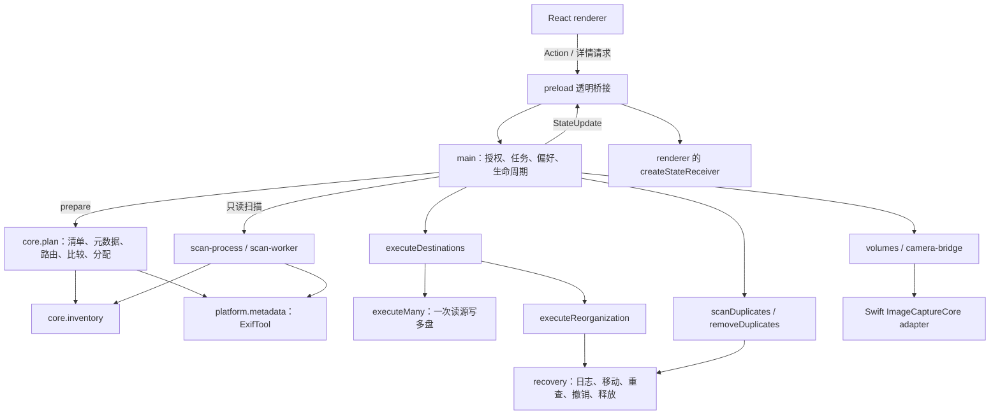
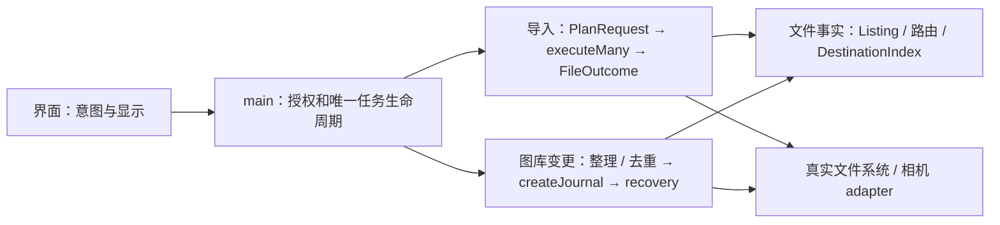

# 实际功能、接口与架构审查

审查日期：2026-10-23；第一次基线 `daaabd8`。**本文已于修复完成后按 `main@7eee02c` 更新**：第 3–7、9–11 节描述的是修复后的代码；R1–R13 的原始发现与处理结果见第 7 节。修复按 [修复计划](superpowers/plans/2026-10-23-architecture-remediation.md) 第 9 节（任务 A1–A17）执行，旧轮次的结论仍可从 Git 历史查阅。

**结论：一个功能一个实现。** 修复后：任务只有一条生命周期；实际文件结果只有一个出口，去重、落位记忆和删除原件都消费它；内容摘要只归 `DestinationIndex`；目录规则、名称校验、同名处理、目录清理、日志建立、错误身份、剩余时间、元数据解释各只有一处实现。没有新增通用 manager、repository 或 event bus。

运行时间、吞吐和内存没有做规模化实测；文中只记录已测的回归项（见第 10 节）。

## 1. 第一性原理与判定规则

应用最终只需完成四件事：发现来源与目的盘；把源文件映射为明确的目标；执行复制或整理并确认结果；把结果交给界面。一个功能只有一个权威 implementation；同一功能的不同按钮应汇入同一条实现。

采用 Matt 的术语：module 是提供 interface 的实现集合；interface 包括类型、时序、错误和信任条件；depth 是调用者通过小 interface 得到的能力；seam 是行为替换位置；adapter 处理真实环境差异；locality 指规则和修改集中在同一处。

判定不看文件长短，而看：

- 删除一个 module 后，复杂度直接消失，还是重新散落到调用者？前者可以删；后者原来承担了职责。
- 同一事实是否有两个维护者，例如同一文件的 SHA-256 在两个记录中采用不同失效规则？
- 同一批数据是否经过序列化、复制、全表筛选后，调用者只取其中一小部分？
- 是否为尚不存在的第二个实现设计 interface？测试替身可以留在 implementation 内部，不必变成产品选项。
- 产品配置与重复实现分开判断。六种目录布局现在共用一个路由实现；它们不是六套复制引擎。是否删掉布局选项，需要产品选择，不能从源码自行推断用户不要某一项。
- 校验、恢复日志与真实文件系统能力差异有明确作用；不把它们统称“兜底”后删除。相反，吞错后标记成功、重复重试、未使用的结果字段应直接收敛。

未发现 `GLOSSARY.md` 或 `docs/adr/`，本轮没有新增术语体系或决策流程。

## 2. 当前实际架构

这不是“每一层都重复传文件内容”：媒体字节在文件系统复制、哈希线程、相机暂存路径流动；renderer 接收的是清单、计划、状态和按需详情。必须区分两种成本。

核心链路：

- **媒体导入**：`action → enqueue → pump → startJob → run → prepare → plan(按意图的 PlanRequest) → executeDestinations → executeMany → stageMany/publish → FileOutcome → finishJob`。
- **预览**：`previewSource → prepare` 保存 `Prepared`；`applyReview → run` 使用同一计划，不由界面把 JSON 计划传回执行。
- **整理**：多个入口进入 `queueOrganization → prepare → executeReorganization → beginOrganization → createJournal → recovery.run`。
- **去重移除**：`scanDuplicates → resolveGroups → removeDuplicates → beginDuplicateRemoval → createJournal → recovery.run`。候选规则和移动执行是不同职责，共用恢复执行。
- **相机**：Swift 下载至临时文件夹，再进入同一个导入计划器；Swift 不是第二套归档实现。

## 3. 实际跨进程 interface：8 个方法

全局是 `window.importer`。`DesktopAPI` 有 **8 个方法**：7 个 invoke handler 加一个推送事件。写操作统一经 `action(Action)`；完成状态从订阅读取，`action()` 的 Promise 完成不等于后台任务完成，命令失败写入 `state.error`。所有 handler 先 `trusted(event)` 检查来源帧；读文件的还经过 `allowed()` 的已选路径授权。

| interface | 通道 | 唯一 implementation |
|---|---|---|
| `state()` | `importer:state` | `stateChannel.snapshot(state)`，自包含的 reset 快照 |
| `subscribe(listener)` | `importer:updated` | `emit → createStateChannel.publish`；renderer 的 `createStateReceiver` 解析引用表 |
| `action(Action)` | `importer:action` | `main.action` 的 48 个分支 |
| `thumbnail(path)` | `importer:thumbnail` | `thumbnailSlots → platform/thumbnails.thumbnail` |
| `summary(path)` | `importer:summary` | `metadata(path,{details:false})`：路由用的短标签及缓存，供摘要卡 |
| `exif(path)` | `importer:exif` | `metadata(path)`：全部标签，供 EXIF 面板。原 `inspect` 及其无人显示的内嵌预览已删除 |
| `duplicateGroups()` | `importer:duplicates` | 当前去重分组，按 revision 获取 |
| `errorPaths(jobId,code)` | `importer:errorPaths` | `job-issues.issuePaths`，按需取分组错误的全部路径 |

定义在 `shared.ts` 的 `DesktopAPI`；桥接在 `preload.ts`；注册在 `main.ts` 末尾。

### 原生辅助程序 interface

`camera-bridge.request` 经 stdin/stdout JSONL 发送带 id 的请求，只有 `list` 和 `stage {cameraID,directory}` 两个命令；返回 result/error/progress。取消 stage 会关闭整个 bridge，所有 pending 请求一起失败，不是单请求取消。相机正在 stage 时来源查询读缓存，避免排队阻塞。

同一个原生可执行文件另有独立 CLI `--set-file-times created modified`，通过继承的 FD 3 调用 macOS 文件时间操作，不接收目标路径；这是文件时间 adapter，不是第三个 JSONL 命令。见 [camera-bridge.ts:62](../desktop/platform/camera-bridge.ts#L62)、[main.swift:28](../Sources/CameraBridge/main.swift#L28)、[file-timestamps.ts:46](../desktop/platform/file-timestamps.ts#L46)。

## 4. Action 全量清单：48 个入口对应的实现

同一功能的多个按钮汇入一个 Action；只差参数的旧 Action 已合并（`scanSource/scanSources → scan`，`clearError/clearErrorIds/clearErrors → clearErrors`，恢复列表的 4 个 Action → `recovery{op}`，`organizeFolder/organizeSourceFolder → organizeFolder`，`skipFile/skipAndContinue → skip`）。

| 功能 | Action | 实际 implementation |
|---|---|---|
| 刷新设备和目的盘 | `refresh` | `main.refresh`：每次一份卷快照（`mountedVolumes`），路径到卷只经 `volumeOf` |
| 选择来源文件夹或整盘 / 勾选 / 忘记 / 重连提示 / 置顶 | `chooseSource`、`selectSource`、`forgetDevice`、`dismissReconnected`、`moveToTop` | `resolveFolderSources`、`DeviceSelection`（只记住卷 UUID 或 `camera:` id）、`queue-order.moveToFront` |
| 选择 / 移除目的地 | `chooseDestination`、`removeDestination` | `validateDestination` |
| 只读扫描一个或全部已选来源 | `scan{sourceId?}` | `startScan → scan-worker → inventory/analyzeSourceCameras`；路由增量用 `beginRoutingCapture` |
| 开始 / 暂停 / 停止 / 重试 / 跳过 | `start`、`pause`、`stop`、`retryJob`、`skip{jobId,path?,all?}` | `enqueue → pump → startJob → run → finishJob`；重试与跳过重入同一计划器 |
| 已知问题标为已处理 / 清除错误显示 | `acknowledgeErrors`、`clearErrors{ids?,severity?}` | `acknowledgeJob`；`error-log.clearErrors` |
| 审核导入或整理 / 改用文件日期 / 应用 / 丢弃 | `preview`、`previewOrganization`、`reviewFileDate`、`applyReview`、`discardReview` | `previewSource → prepare`；应用使用同一个 `Prepared`，审核后的整理与一键整理是同一种任务 |
| 整理目的地 / 文件夹 / 备份目录 | `organize`、`organizeFolder{sourceId?}`、`organizeBackup` | `queueOrganization → prepare → executeReorganization → beginOrganization → recovery` |
| 整理范围与本次选项 / 继续 | `chooseOrganizationFolders`、`resetOrganizationFolders`、`organizeOptions`、`continueOrganization` | `takeOrganizeOptions/sourcePolicy`（本次选项是唯一权威，排队或审核时冻结并重置） |
| 恢复列表与操作 | `refreshOrganization`、`recovery{op:'resume'\|'finalize'\|'undo'\|'delete'}`、`measureOrganizationRecovery` | `listOrganizations`；`resumeOrganizationJob(op)` |
| 删除已备份原件 | `measureOriginals`、`deleteOriginals` | `core/originals`：登记在 `originalsControls`，可停止、退出时等待、保持唤醒；停止后已删文件照样报告 |
| 移除重复项 | `duplicatesScope`、`duplicatesChooseFolder`、`duplicatesScan`、`duplicatesStop`、`duplicatesRemove` | `scanDuplicates`；`resolveGroups → removeDuplicates → beginDuplicateRemoval → recovery` |
| 清理残留 / 删除旧收据 / 确认旧记录 | `cleanResidue`、`removeReceipt`、`acknowledgeOldRecords` | `findResidue/cleanResidue`；`core/old-records.ts`（确认前拒绝整理与移除重复；转换器已删除，最后能转换的构建是 `records-migrator-v5`） |
| 设置 / 未知格式规则 | `preferences`、`unknownRule` | `acceptedPreferences(settingsLocked) → normalizePreferences → save`；目录设置保存时经 `checkFolderSettings` |
| 诊断日志 | `logOpenFolder`、`logCopyPath`、`logExport` | `log-export.exportLogs`：只导出 zip，失败写 `state.error` |
| 在访达中显示 / 窗口 | `reveal`、`window` | `allowed → shell.showItemInFolder`；BrowserWindow |

## 5. 核心功能与规则的唯一归属

### 5.1 发现、扫描、路由与复制

| 功能 | 核心 interface → implementation | 数据 / 约束 |
|---|---|---|
| 挂载卷发现、容量与物理盘识别 | `mountedVolumes/getSources/volumeInfo/volumeOf` → `platform/volumes.ts` | 三个 OS adapter；每次刷新一份快照（种类直接来自系统描述），路径到卷只经 `volumeOf`；新进程首次查卷只描述该路径所在的挂载；稳定 id 只用卷 UUID 或 `camera:` id |
| 文件夹来源合并及所属物理盘 | `resolveFolderSources` → `folder-sources.ts`；展示分组 → `drive-groups.ts` | 多个文件夹仍是独立 Source；共享一块盘时由路径最前的来源显示容量，不随置顶变化；同盘读并发受 device 规则控制 |
| macOS 协议相机 | `cameraSources/prepareCamera` → `platform/camera-bridge.ts` → Swift `DeviceDiscovery` | JSONL list/stage；下载暂存后进入文件系统计划；非 macOS 无 PTP implementation |
| 清单、系统文件、未知格式、空文件 | `inventory` → `core/inventory.ts` | `media-formats.ts` 是格式目录；`known-files.ts` 是系统文件识别。复用记录是 `Listing`（目录 key、名称、大小），不再伪造 Inventory；大小过期时只重读那个父目录 |
| 伴随文件与 Live Photo | `inventory` 的 `companionOf` + `pairLivePhotos` → `core/index.ts` | XMP/AAE/DOP、LRF/XML/音频、NKSC、ContentIdentifier 等；family 共同分配，不能拆盘。按名字模式配对的（Sony M01.XML/R01.BIM、IMG_O….AAE、GoPro/Insta360 LRV）也接受同名规则加的 ` (n)`，只与相同编号配对 |
| 相机/镜头汇总 | `analyzeSourceCameras` → `source-cameras.ts` | 元数据证据与盘名/目录提示分开；扫描新增路由结果回传 main |
| 路由元数据 / 完整详情 / 内嵌图片 | `metadata` → `platform/metadata.ts`，解释只经 `metadataFromTags` | 同一个 ExifTool；路由读短标签并缓存，EXIF 面板读全部标签；瞬间转换只用 `capture-time.captureTimestamp`；快门数为数字，由界面格式化；`embeddedPreview` 只供缩略图 |
| 日期、相机、编辑导出与目录布局 | `plan → folder/layoutFolder` → `core/index.ts`；token 与展开 → `folder-template.ts` | 六个 layout 是同一个路径函数的分支；设置预览调用同一套 token；落位与路由记忆共用 `routing-options.rulesScope`（含未知格式规则） |
| 缺日期 / 相机、未知格式目标 | 同一 `folder` / 计划器 | 缺失信息使用明确目录；不凭空补造 EXIF；自定义未知格式规则是产品配置。目录名只经 `validateRelative/validFolderName` 一套规则，导入与“设置”共用 `checkBackupFolders`，能保存的名字就能计划 |
| 目标已有内容比较、同名冲突 | `existingMatches/allocate/target` → `core/index.ts` | 同尺寸再确认 SHA。同名不同内容由偏好 `conflictNaming` 决定：`folder`（默认）放入 `Conflicts/<内容 id>/`，`number` 改名为 `name (n).ext`，整个 family 共用 n；已有相同内容的 ` (n)` 视为已备份 |
| 单盘 / 双盘副本 / 顺序填盘 | `fillFirst/allocateDestinations` → `core/allocation.ts` | 按 family 分配；顺序填盘先分盘再命名，第二盘只为第一盘放不下的 family 计划；盘 1 份额一选定即预留；每块物理卷一个预留键 |
| 容量预留与目的盘校验 | `prepare/availableFor` + `destinationRoots/validateDestination` | 卷身份、路径包含关系和并发任务预留；预览也持有预留 |
| 复制与发布 | `executeDestinations → executeMany → stageMany/publish`，exFAT 直写 `finishDirect` → `core/index.ts` | 同一源块写多个目标；目的盘失败隔离。每个目标在最终同步后发出一次 `FileOutcome`（实际路径、published/existing/routed、content-verified 或 stream-only）；去重记录、落位记忆、可删原件都只消费这一份 |
| 哈希 | `Hasher.update/digest/drop` → `core/hasher.ts`；文件读取 → `paths.digest` | worker 与本地计算同一 SHA 语义；复制时边读边 hash 与重新读取文件不是两套校验规则 |
| 中断续传 | 暂存/收据操作 → `core/import-recovery.ts` | 只复用已证明归属且身份一致的临时文件；不能把任意同名文件当作续传数据 |
| 整盘只增 / 镜像 | 目录归属、`mirrorChanges/moveMirrorRemovals` → `core/drive-backup.ts` | 普通用户文件保留目录；镜像差异需审核后移入 `.mirror-removed`，不直接传播删除 |
| 源文件失败与跳过 | `plan` 的 failure/exclude/skipErrors | 重试共用原计划器；镜像和协议相机有不同可跳过限制 |

### 5.2 整理、恢复、去重与清理

| 功能 | 唯一 implementation | 实际行为 |
|---|---|---|
| 整理已有图库 | `executeReorganization → beginOrganization → createJournal → recovery.run` | 计划绑定进程内审核身份；新日志一律 rename（无 strategy 的旧日志仍按 copy 读取）；整理与去重共用一个私有 `createJournal` |
| 异常媒体归集 | `plan` 的 problems + recovery | 空文件及其族、不可读文件按规则留原地或归入 Problem files，不混入正常照片目录 |
| 恢复继续 / 重查 | `resumeOrganization` | 根据日志确认已完成状态，再继续；full 明确要求重新读取全部内容 |
| 撤销 | `undoOrganization` | 把仍能证明归属的文件放回；识别后续整理的接管关系 |
| 释放原件 | `finalizeOrganization` | 确认目标副本后释放恢复存储，不等同撤销 |
| 恢复文件测量与删除 | `measureOrganizationRecovery/deleteOrganizationRecovery` | 结束/被取代日志、依赖关系、实际保留内容分别处理 |
| 文件夹错位检查 | `findMisplaced → planOnce` 的只路由分支 | 无第二套路径规则；off/ask/auto 只是检查/执行策略 |
| 去重扫描与候选分组 | `scanDuplicates` + `duplicate-rules.ts` | 摘要只经 `DestinationIndex`（可证明 stat），`DuplicateStore` 只存元数据；读取失败返回 `failures` 并显示未读数量，同次扫描每个文件只算一次摘要。级别为 1、2：自动处理只针对 SHA 相同的组，EXIF 组等用户确认 |
| 导入后去重记录 | `recordDuplicates` 消费 `FileOutcome` | 只记录本次实际发布的结果；计划与扫描用同一成员过滤（非 Other、大于 0 字节、非伴随文件） |
| 移除重复项与附属文件 | `removeDuplicates → beginDuplicateRemoval → recovery.run` | 审核决定保留者，确认身份/内容，处理伴随文件，保留撤销所需记录 |
| 删除已备份来源原件 | `core/originals.deleteOriginals` | 独立显式操作，仅文件夹导入提供；资格来自实际结果，且须覆盖分配要求的全部目标（镜像两盘、顺序填盘为所分配的盘）；删除前重读各目标，源在 APFS/HFS+ 且身份未变时不重读；停止不丢已删结果 |
| 目录清理 | `redundant-folders.removeEmptiedFolders`，由日志与删除原件调用 | 唯一实现：只删本次清空的目录，自下而上、同设备、不跟随链接；服务文件可删，`._` 仅当 `inspectAppleDouble` 判定只含记账信息；新日志签名记录清理范围 |
| AppleDouble 清理 | `AppleDoubleCleaner/inspectAppleDouble` | 判断 `._` 内容；不确定项保留并报告警告；不是任意删除所有隐藏文件 |
| 中断残留清理 | `findResidue/cleanResidue` | `resumable` 与 `kept` 分开计数；自动清理两者都保留；显式清理可处理更多残留 |

### 5.3 状态、显示、资源与持久化

| 功能 | implementation | 当前归属 |
|---|---|---|
| 偏好校验 / 默认值 / 旧设置迁移 | `preferences.normalizePreferences` | 读盘和更新共用；当前默认 parallel=5（范围 1–10）、字号 125%（范围 100–200%）、mediaLayout=video-root，以源码为准 |
| 本次整理源动作 | `run-policy.sourcePolicy` | 导入 copy；整理 rename；本次 OrganizeOptions 决定清目录/释放重复项 |
| 状态发送与接收 | `state-channel.createStateChannel/createStateReceiver` | 一个引用表：清单、任务错误与分组明细、问题文件、错误日志、历史、去重 earlier 列表、审核；按版本只在变化时发送 |
| 错误聚合、显示清除与按需路径 | `job-issues/error-groups/error-log/acknowledge` | 错误写入只经 `addErrors/recordIssue`，身份在记录时确定；错误日志缓存按真实变更版本重建，等长替换也会更新 |
| 四语言与消息 | `messages.ts` + `renderer/i18n.tsx` | 后端发 Message key/参数，前端翻译；部分原生/低层错误保留原文 |
| 导入页、来源详情、审核、组织、设置、历史 | `renderer/RootApp.tsx` 中具体界面函数 | 同一个 React 应用；list/grid 是展示配置，不改变复制逻辑 |
| 去重页 | `renderer/DuplicatesPage.tsx` + `renderer/duplicate-details.ts` | 详情按 root + revision 分代缓存，成功与在途分开，单项失败可显式重试；共享界面组件见 A13 |
| 缩略图 | `platform/thumbnails.ts` | macOS 系统 decoder/视频海报，必要时提取内嵌图片；磁盘图片缓存；其它 OS 系统 decoder 返回不可用 |
| 启动画面、品牌与动画 | `Boot/boot-controller/BrandLogo/styles.css` | 纯呈现，不参与文件计划和执行 |
| 并发与物理盘 I/O | `pump`、`core/devices.ts`、`queue-order.ts` | 任务槽位与盘读写限制是两个不同约束；同盘目录来源不能当独立硬盘 |
| CPU/内存设置 | `resource-limits.ts`、`threadpool.ts` | 一个已保存上限的读取供线程池和偏好共用；界面写“上限”而非实测用量；内存是软预算，非进程总量硬上限 |
| 剩余时间 / 速率 / 历史先验 | `eta.ts/eta-model.ts/eta-priors.ts/eta-format.ts`、`rate-meter.ts` | 一个估计器 `JobModel`（列目录为显式估计总量步骤）；`job.eta` 存模型秒数；显示保持与分桶只在界面做一次（`useHeld`）；没有测量时显示不确定进度条 |
| 目录枚举进度提示 | `listing-estimate.ts/platform/listing-memory.ts` | 只用于估算，不决定复制是否正确 |
| 盘活动与防休眠 | `platform/drive-activity.ts/keep-awake.ts` | 主进程采样系统指标、任务期间保持唤醒 |
| 延后恢复列表刷新 | `deferred-refresh.ts` + main | 任务忙时推迟必要读取，避免与正在进行的 I/O 竞争 |
| 设置/历史、报告、恢复密钥 | `main.save/initializeRecoveryKey` 与各任务报告 | userData 设置/历史、operation-reports；恢复 manifest 在图库恢复目录 |

## 6. 数据流与重复成本

### 6.1 当前做法

1. 状态通道的一个引用表覆盖清单、任务错误与分组明细、问题文件、错误日志、历史、去重 earlier 列表和审核；只有版本变化的明细随更新发送，进度消息不再重复序列化不变的大字段。`Inventory.listing` 不发给 renderer。
2. 扫描子进程只回传本次新读到的路由条目（`beginRoutingCapture`，按秒 flush），main 按来源在 module 内筛选保存（`routingEntriesUnder`），不再整表复制后再找增量。
3. 多目的地仍是 `stageMany` 一次读源、写多个目标；各目标独立回读校验。实际结果每个目标发出一次，主进程按来源建一个 Map，完成阶段线性消费。
4. 单文件详情：摘要卡用 `summary` 的短标签，EXIF 面板用 `exif` 的全部标签，图片按需走 `thumbnail`；没有无人显示的预览经过 IPC。
5. 内容摘要只有 `DestinationIndex` 一份，信任条件为完整 stat（dev/ino/size/mtime/ctime，FAT/exFAT 的 `ctime==mtime` 不可证明）。

### 6.2 仍然存在、本轮有意保留的成本

| 数据 | 流向 | 判断 |
|---|---|---|
| 相机媒体内容 | 相机 → 本机暂存 → 目的盘 | 统一文件系统核心的 adapter 成本；不新增相机专用复制引擎 |
| 哈希块 | 主线程复制 chunk，再 transfer 给 hash worker | 换取主线程不做哈希；没有 profile 不改 |
| 其它 StateFields | 偏好、恢复列表、设备信息仍随更新发送 | 体积小；没有 IPC 体积测量前不改成通用 patch 协议 |
| EXIF 面板 | 第二次读取全部标签 | `RequestAll` 的必要成本；扫描不为界面读全部标签 |

缓存仍按用途区分：`scan-memory` 保存可重新验证的源清单与路由；导入记录保存已校验源摘要；`placement-memory` 只证明上次规则下“位置正确”；`listing-memory` 只是进度估算；`DestinationIndex` 是唯一可信摘要；`DuplicateStore` 只存去重用的元数据。

## 7. 原始发现与处理结果

第一次审查（基线 `daaabd8`）的 R1–R13 均已处理。下表列出最终做法和对应任务；原始证据与行号见 Git 历史中本文件的上一版本。

| 编号 | 原始问题 | 处理结果 | 任务 |
|---|---|---|---|
| R1 · P1 | 删除原件绕开任务生命周期，Stop 和退出管不到 | 登记在 `originalsControls`：可停止、退出时等待、计入空闲判断、保持唤醒、受设置锁约束；停止后已删文件照样报告，预检与目录清理阶段的停止都不抛异常 | R-T01 / review-4 |
| R2 · P1 | 去重 EXIF 读取失败被记成已读 | 只在成功时记录；失败进入 `failures` 并显示未读数量；同次扫描每个文件只算一次摘要 | A3 |
| R3 · P2 | 导入完成阶段二次方遍历 | 按来源一次建 Map | review-4、A2 |
| R4 · P2 | 为找扫描增量每秒复制整个路由缓存 | `beginRoutingCapture` 只记新读条目；`routingEntriesUnder` 在 module 内筛选 | A6 |
| R5 · P2 | `inspect` 与 `exif` 重复，且生成无人显示的预览 | 删除 `inspect` 与预览；文字详情分 `summary` / `exif` 两种真实需求 | review-4、A8 |
| R6 · P1 | 去重页“已请求”与“已有结果”状态混在一起 | `duplicate-details.ts`：按 root + revision 分代，成功与在途分开，失败可显式重试 | review-4、A11 |
| R7 · P2 | 进度更新携带不变的大明细 | 引用表加版本，只在变化时发送；错误日志缓存按真实变更版本重建 | review-4、A9 |
| R8 · P2 | 去重与目标索引重复拥有“文件是否可信” | 摘要只归 `DestinationIndex`；`DuplicateStore` 不再存 SHA，元数据缓存用同一 stat 谓词 | A3 |
| R9 · P2 | 持久偏好与本次整理选项存在假入口 | 删除失效的持久偏好及 `livePreferences`；本次选项是唯一权威 | review-4、A12 |
| R10 · P3 | 计划请求过宽 | `PlanRequest = ImportRequest \| DriveRequest \| OrganizeRequest`，另有只读的 `MisplacedRequest`；都走一个 `planOnce` | A15 |
| R11 · P2 | 无消费者的变体与公开整理策略 | 删除 `restore`、`mode:'recorded'`、持久分组；`strategy` 不再公开，新日志固定 rename；两种日志共用 `createJournal` | A3、A4 |
| R12 · P1 | 执行事实不集中返回，完成阶段用旧计划路径 | `onFileOutcome` 每个目标一次；去重、落位、可删原件只消费它；晚分配到 `Conflicts/` 的实际路径被如实记录；三套目录清理收为 `removeEmptiedFolders` 一套 | A2、A4 |
| R13 · P3 | ETA 与排队的无用状态 | 删除第二估计器与无读者状态；排序直接返回任务；显示保持只在界面一处 | review-4、A10 |

修复过程中另行发现并处理：顺序填盘第二盘把文件误放进 `Conflicts/`（A1）；`removeRedundantFolders` 的计数恒为 0（A4）；无 UUID 卷被两个任务各算一次空间（A2）；A7 新进程首次查卷做全系统扫描，使崩溃恢复测试慢 5 倍（集成时修复）；按名字模式配对的伴随文件在 ` (n)` 改名后不能再配对（A17 集成时修复）。

## 8. 应保留的深 module 与真实 adapter

| 对象 | 删除测试 / 保留理由 |
|---|---|
| `scan-process/scan-worker` | 隐藏进程生命周期、停止、内存设置和卡死卷隔离；删除会把复杂度和阻塞风险移回 main |
| `executeDestinations` | 不只是转发：照片/视频归属物理目标、容量释放、进度汇总、故障隔离都在此发生 |
| `executeMany/stageMany` | 多目标共享源读取；改成“每盘自己 copy”会失去已有 leverage |
| `recovery` | 整理和去重已共享日志执行；签名、续作、撤销、后续接管分别对应真实状态 |
| `sourcePolicy` | 小 interface 隐藏“导入不能被旧设置变成移动”的规则；删除会让各入口重复判断 |
| OS 卷枚举和 ImageCaptureCore | 真实操作系统接口不同；此 seam 有真实 adapter，不是预留的假替换能力 |
| 硬链接与独占复制 | exFAT 等文件系统能力不同；独占发布与目标回读不能凭代码短就删除 |
| 路由 EXIF 与完整 EXIF | 扫描不应为每个文件读取完整标签/预览；精简读取和详情读取是同一 module 的不同需求 |
| 缺失/损坏缓存视为 miss | 缓存不是用户数据的权威来源；直接重算是正常行为，不应为了“无兜底”变成无法导入 |

`execute()` 是 `executeMany([transfer])` 的便捷入口，不是第二套复制引擎；如无生产消费者可内部化，但价值低于以上问题。`main.ts`/`RootApp.tsx` 长也不自动等于架构错误；只有把完整职责和状态一起移走，才有 locality 收益。

## 9. 收敛后的形态

两条业务主线：**导入复制**、**整理/去重的可恢复变更**。二者共享清单、路由与内容事实；renderer 只提交意图、显示结果。任务登记只有 main 的 `startJob/finishJob`；文件内容身份只有一个摘要规则；实际做了什么只有一个结果出口。

没有引入的东西：任务框架、通用缓存或仓库层、卷/相机端口、按厂商的解析策略、状态 patch 协议。这些在审查中都被判定为浅 module 或无测量依据。

## 10. 验证

修复分两波并行开发，每波合并后做独立的合并审查、typecheck、全量 `npm test`、`npm run build`，并单独计时 `process-crash.test.ts` 以发现性能回归。

- 波次 1 集成（`f649710`）：全量测试连续两次 0 失败（1603 项）。期间发现并修复 A7 使 `process-crash` 从 9 s 变成 42 s 的回归。
- 波次 2 与 A17 集成（`f68d3b6`）：全量测试连续两次 0 失败（1643 项）；`process-crash` 与合并前同等。
- 与 UI 审计分支合并后的 `main@7eee02c`：typecheck 与 build 通过；全量 1651 项，在系统负载约 400 时有 2 项计时测试失败，单独运行通过，且同一心跳测试在修复前代码上同样失败。

未做：真实相机卡、双物理盘、Windows/Linux 实机、物理断电；Swift 桥接的一处删除未编译；IPC 体积与峰值内存没有规模化测量。

## 11. 修复计划

方案、利弊、迁移与验收记录在 [修复计划](superpowers/plans/2026-10-23-architecture-remediation.md)；第 9 节是合并后的任务表 A1–A17 与执行波次。同日的 [deep-interfaces](superpowers/plans/2026-10-23-deep-interfaces.md) 计划已并入其中。

## Release note: files without metadata

Files with no capture date, no camera and no known origin, or with unreadable metadata, are left where they are by default (Settings > Importing > Files without metadata); imports do not copy them and Delete originals never removes them. Choose "Move to a folder" to file them under one folder directly under the library (default `Unknown files`, also under the video root for videos), or "Use file date" for the old routing. The `Unknown Camera` folder is no longer created. Under "Use file date" a file without a camera is filed as `<date>/Unknown files/` where it used to go to `<date>/Unknown Camera/`. A job someone starts (Start, Import now, Organize now, Organize backup, Organize folder) stops at the review and shows a warning when it finds such files; automatic imports record the warning in the job's issues instead.
