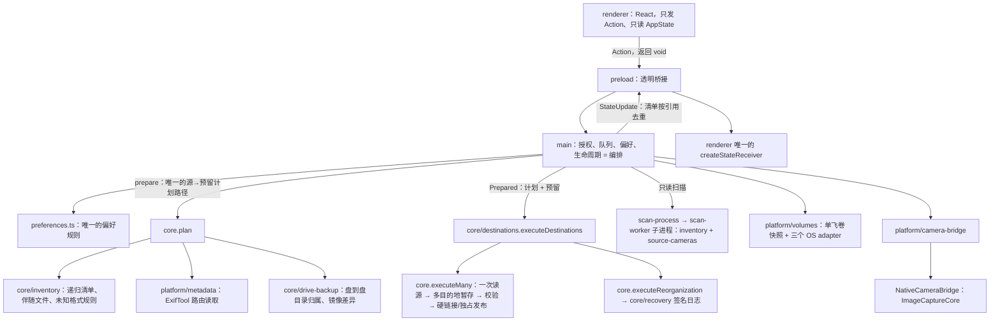

# 实际功能、接口与架构审查

审查日期：2026-10-21（第三轮）。范围：当前 Electron 桌面程序（`desktop/`）及其仍在使用的 macOS ImageCaptureCore 相机 adapter（`Sources/`）。结论只依据当前代码和本轮实际运行的验证；以往报告、界面文案和计划不算作功能完成的证据。第二轮之后另有会话加入了盘到盘镜像、设备记忆、扫描记忆、备份目录错位检查、整理撤销/释放、暂停等功能，本轮把它们一并纳入。

## 方法

使用 Matt Pocock `codebase-design` 的词汇：**module**（有 interface 和 implementation 的任何东西）、**interface**（调用者必须知道的一切，含不变量、错误模式和性能特征）、**depth**（单位 interface 背后的行为量）、**seam**（不改该处代码即可替换行为的位置）、**adapter**（在 seam 上满足 interface 的具体实现）。判断标准：

- **删除测试**：删掉一个 module，若复杂度消失，它只是转发层；若复杂度在 N 个调用者处重现，它在发挥作用。
- **一个 adapter 是假想的 seam，两个才是真的**：只有真实不同的 OS 接口或测试替身才保留 seam。
- **一个功能一个实现**：界面可以有多个入口（一键整理、先审核再整理、整理任意文件夹），但它们必须进入同一条实现路径。
- **数据安全冗余 ≠ 软件冗余**：校验、日志、恢复区、身份绑定是防不同故障的保护；重复实现、重复校验规则、跨层来回传同一份数据才是要删的冗余。

## 第一性原理：应用必须做的事

1. **发现**源（挂载的卡/读卡器/大容量存储相机、macOS 相机协议、手选文件夹）和目的地（带卷与物理盘身份）。
2. **计划**：源的实际内容 → 清单 → 元数据（相机、拍摄日期、是否编辑导出）→ 每个目的地的目标路径、重名分配与空间预留。
3. **执行**：按计划复制并验证；或在同一文件系统内整理（移动 + 签名日志），可中断后重查/继续/撤销。
4. **呈现**：界面展示状态并发出用户操作；它不决定落盘规则，也不把数据传回核心。

对应的分层（依赖只向下）：

## 功能接口清单（一个接口 → 一个实现）

renderer 与 main 之间只有 `DesktopAPI` 的四个方法：`state()`、`subscribe()`、`action(Action)`、`inspect(path)`。所有写操作都是 `Action`，结果统一经订阅回到界面。

| 功能 | 入口（Action / API） | 唯一实现 |
|---|---|---|
| 初始状态与订阅 | `state()` / `subscribe()` | `state-channel.ts`：`createStateChannel` 只发送引用变化的清单与审核；renderer 中唯一的 `createStateReceiver` 重建 `AppState` |
| 单文件照片/EXIF | `inspect(path)` | `allowed()` 授权路径 → `platform/metadata.metadata`（完整标签 + 预览） |
| 刷新源与目的地 | `refresh`、5 秒定时、⌘/Ctrl+R | `refresh()`：一份 `mountedVolumes()` 快照同时给 `getSources` 与 `volumeInfo` |
| 挂载卡 / 读卡器 / 大容量存储相机 | 自动 | `platform/volumes.ts`：macOS/Windows/Linux 三个解析 adapter，`classifyVolume` 统一判定相机布局 |
| macOS 相机协议 | 自动；导入时暂存 | `platform/camera-bridge.ts` ↔ `Sources/CameraBridge` ↔ `DeviceDiscovery`；暂存后进入同一 `plan` |
| 选择要导入的设备、记住/忽略/遗忘 | `selectSource` / `forgetDevice` | `device-selection.ts` 的 `DeviceSelection`（按卷 UUID/相机 id，文件夹不记忆） |
| 手选媒体文件夹 / 整盘备份 | `chooseSource {backup}` | 原生选目录；`allowFolderSource` 开关；`sourceInsideBackup` 在选择时拒绝已在备份里的源 |
| 选择 / 移除目的地 | `chooseDestination` / `removeDestination` | `validateDestination(target,sources)`：拒绝相机卡、源内目录、可移动闪存、只读卷，并记下卷身份 |
| 已保存目的地的身份校验 | 复制、整理、恢复前 | 同一个 `validateDestination(…,{identity})`；身份为空或不符即拒绝 |
| 只读扫描 | `scanSource` / `scanSources` | `scanSourceInWorker` → utility process：`inventory` + `analyzeSourceCameras`；上次清单与元数据作为可校验的复用提示传入 |
| 扫描记忆（跨重启） | 自动 | `platform/scan-memory.ts`：按卷 UUID 保存清单与路由元数据；使用前按目录名与文件 stat 重新校验 |
| 已导入记忆 | 自动 | `scan-memory.rememberImported/loadImported`：stat 不变的卡文件直接用已验证的 SHA-256 |
| 递归媒体识别、伴随文件、系统文件 | 扫描与计划共用 | `core/inventory.ts`；扩展名表唯一在 `media-formats.ts`；厂商系统文件目录在 `core/known-files.ts` |
| 每张卡的相机/镜头 | 扫描 | `source-cameras.ts`：每个媒体读一次路由元数据；盘名/格式/布局只作提示 |
| 偏好（外观、语言、字号、布局、并行、自动、复制策略、路径模板等） | `preferences {patch}` | **`preferences.ts` 的 `normalizePreferences`**：读盘与每次修改走同一套规则；main 只决定哪些键可在任务运行时修改 |
| 未知扩展名规则 | `unknownRule {extension,folder,remember}` | main 保存会话/持久规则；`inventory` 决定是否包含，`plan` 决定去向 |
| **源 → 预留计划** | 审核、直接导入、整理 | **`main.prepare()`**：`destinationRoots`（一次卷快照）→ 相机暂存 → `core.plan` → `allocateDestinations` / `requiredOrganizationSpace` → 按卷预留空间 |
| 审核 / 应用 / 丢弃 | `preview` · `previewOrganization` / `applyReview`（或审核打开时的 `start`）/ `discardReview` | 审核 = 保存 `prepare()` 的结果；应用 = 同一个 `Prepared` 及预留交给 `run()`；丢弃释放暂存与预留 |
| 开始 / 停止 / 暂停 / 自动 / 1–5 并行 | `start` / `stop` / `pause` / `preferences {automatic,parallel}` | `enqueue` / `pump` / `run`；`AbortController`；暂停 = 带“可继续”标记的停止；降并发只影响后续槽位 |
| 单盘、双份副本、先满第一盘 | `preferences {copyMode}` | `core/allocation.allocateDestinations`；双盘由 `destinationRoots` 要求不同物理盘 |
| 多目的地执行 | `run` 内 | `core/destinations.executeDestinations`：逐盘实时校验、单盘故障隔离、合并进度与剩余预留 |
| 内容验证复制 | `executeDestinations` 内 | `core.executeMany`：源读一次写到所有目的地暂存 → 暂存回读哈希 → 硬链接或独占复制发布 → 原件保留；中断的半写文件凭签名收据续写 |
| 盘到盘备份（只增 / 镜像） | `preferences {backupMode}` + `chooseSource {backup:true}` | `core/drive-backup.ts`：每个源盘在目的地拥有一个带标记的目录；镜像差异只在审核后把多余文件移入 `.mirror-removed`，从不删除 |
| **整理现有文件** | `organize`（整个目的地/所选子目录）、`organizeFolder`（任选文件夹就地）、自动备份目录整理、`previewOrganization`（先审核） | **`main.queueOrganization()`** → 同一 `prepare()` → `executeReorganization` → `core/recovery` 签名日志（rename，跨卷/空文件回退到校验复制） |
| 整理范围 | `chooseOrganizationFolders` / `resetOrganizationFolders` | main 保存每个目的地的子目录列表，作为 `plan` 的 `sourceFolders` |
| 备份目录错位检查 | 自动（`autoOrganizeBackup`：off/ask/auto） | `core.findMisplaced` = `plan` 的只路由模式；`auto` 时导入完成后排入 `queueOrganization` |
| 整理恢复列表 / 重查继续 / 撤销 / 释放原件 | `refreshOrganization` / `resumeOrganization` / `undoOrganization` / `finalizeOrganization` | `core/recovery.ts`：`getOrganizationRecovery`（不重哈希）、`resumeOrganization`、`undoOrganization`、`finalizeOrganization`（全部目标重验后才释放）；main 用一个 `resumeOrganizationJob(kind)` 承载三者 |
| 清空的源目录清理 | 整理完成后 | `core/redundant-folders.removeRedundantFolders`（只删仅含系统服务文件的目录） |
| 后台消息本地化 | 状态里的 `Job.detail` / `Job.errors` / `AppState.error` / `history` | **`messages.ts`**：唯一的 key → 四语言目录；`message()` / `joined()` / `text()`（原文）构造，`MessageError` 携带 key 并以英文作 `Error.message`（日志、报告），`toMessage` 把任意错误转成消息；renderer 的 `createTranslator` 直接接受消息。旧版 `settings.json` 中的字符串历史在读取时由 `savedMessage` 转为原文消息 |
| 窗口按钮 / 在访达中显示 / 清除错误 | `window` / `reveal` / `clearError` | Electron 窗口 API（Windows/Linux 无原生框时使用）；`allowed()` 授权后 `shell.showItemInFolder` |
| 集成测试 | `npm run codex:test` | `Scripts/codex-test.mjs` + `desktop/qa/codex-smoke.ts`，临时 fixture 与独立 userData |
| 真实硬件导入测试（TEST-16） | `--hardware-test-a006` | `desktop/qa/a006-hardware.ts`；目标盘与卷 UUID 只在该模块定义一次 |

## 本轮发现与修复

| # | 问题（臭味） | 修复 | 证据 |
|---|---|---|---|
| 1 | **同一操作三份排队代码**：`organize`、`organizeFolder`、`queueBackupOrganization` 各自复制“审核中/已有整理”守卫、拼 `Job`、写 `organizationQueue`。三者本质都是“把某根目录整理到 prefs 的单一目的地/basePath” | 一个 `assertOrganizationIdle()` + 一个 `queueOrganization(root,name,request)`；三个入口只决定根目录、名称和偏好快照 | 类型检查；`organize-backup`、`redundant-folders`、`organization-rename` 测试；Electron 冒烟中的一键整理 |
| 2 | **失效接口**：`Action {type:'organizeBackup'}` 没有任何界面或测试调用者，只有内部自动整理走同一函数 | 从 `Action` 与 `action()` 中删除；自动整理直接调用 `queueBackupOrganization` | 类型检查（无调用者） |
| 3 | **同一规则两份实现**：`load()` 与 `preferences` 动作各自校验/修正偏好（字号、并行数、复制模式、备份模式、校验开关、未知格式默认、设备记忆…），而且不一致：读盘不校验 `copyMode`/`appearance`，修改时不过滤设备记录；默认值对象被共享引用，可能被就地修改 | 新的纯 module `desktop/preferences.ts`：`defaultPreferences` + `normalizePreferences(input, base)`，无效字段保留 `base` 的值；main 的两处都调用它，动作只保留“哪些键运行中可改”的编排判断 | 新测试 `preferences.test.ts`（先失败后通过） |
| 4 | **检查放错范围 + 三份重复**：`destinationRoots` 对“所有已连接源”检查是否位于备份目录内——一张无关的卡或文件夹在备份目录内，就会让其他所有导入失败；同一判断还在 `sourceInsideBackup`（选择时）与 `plan`（权威、按 realpath）各有一份 | `destinationRoots(prefs,sources,importing?)` 只检查本次导入的源，并复用 `sourceInsideBackup`；整理任务不传（它的源本来就包含备份目录） | 新回归测试“另一已连接源在备份目录内不阻止本次导入”（修复前失败、修复后通过） |
| 5 | **跨进程来回传同一份数据**：扫描时 main 把该源已有的路由元数据发给扫描子进程，子进程结束时把缓存“全部”回传（含刚收到的），main 再逐条 `structuredClone` 存回 | 子进程只回传本次新读到的条目 | 代码路径；扫描进度/扫描记忆测试 |
| 6 | **硬件测试常量两份**：生产 `main.ts` 启动路径内硬编码 `/Volumes/A006` 与卷 UUID，`qa/a006-hardware.ts` 再定义一次 | 只在 `qa/a006-hardware.ts` 导出 `hardwareDestination`；main 在 `--hardware-test-a006` 下由它配置偏好 | 类型检查 |
| 7 | **重复工具函数**：`statKey`（dev:ino:size:mtime:ctime）在 `core/index.ts` 与 `core/drive-backup.ts` 各一份 | 移入 `core/paths.ts` 唯一导出 | 类型检查；drive-backup / planning 测试 |

## 保留的复杂度（不是冗余）

- 源变更检查、源/目的地重叠限制、符号链接限制、物理盘身份、独占发布、签名收据、目录同步、恢复区原件：各防一种不同故障（SAFE-01–06）。
- `sourceInsideBackup`（选择/开始前、不创建目录）与 `plan` 内的 realpath 检查：前者是早期、廉价的用户反馈，后者是对实际路径的权威判断，两者时间点不同。
- 独占复制分支：exFAT 等不支持硬链接的文件系统，因此保留完整的目标回读。
- 整理的 `rename` 与“校验复制 + 保留原件”两条路径：rename 是正常路径；复制路径用于跨设备（EXDEV）、空文件和旧版日志的恢复，不是第二种可选样式。
- macOS / Windows / Linux 卷查询：三个真实 OS 接口，是真 seam。
- 只读扫描与导入各自校验元数据：导入复用扫描的路由结果，但只在文件 stat 完全不变时。
- 暂停与停止：同一个中止实现；区别只在任务标记为“可继续”以及停止还会关闭审核和扫描。
- main 中宽松的 `syncDirectory`（设置文件）与 core 中严格的版本（备份目的地）：策略不同，所以两份。

## 已识别但本轮不改

- `Job.inventory` 与 `state.sourceInventories` 指向同一清单对象：状态通道按引用去重，IPC 不重复传输；合并需要改界面“最近清单”的选择规则，收益小。
- `executeReorganization(…,{strategy})`、`getOrganizationRecovery({verifyContents})`、`execute(…,{exclusiveCopy})` 主要供测试使用，按 Matt 原则是暴露在 interface 上的内部 seam。生产总是 `rename`；把默认值改为 `rename` 需要重写大量以复制路径为前提的恢复测试，本轮不做。
- 备份目录错位检查（默认 `ask`）在导入结束和目的地连接时对整个备份目录读取路由元数据。会话内有 stat 缓存，但应用重启后的第一次检查会对大型库运行 ExifTool。若大型库感到卡顿，可以把它的结果也纳入扫描记忆。
- `validateDestination` 拒绝位于任何已连接源内的目的地（DST-04 的保守策略）。因此把整个备份盘（如 `/Volumes/A006`）选为“整盘备份”源时，该盘上的目的地会被拒绝。这和第 4 项修复的方向相反，属于策略取舍，本轮不改。
- `main.ts` 仍承担编排、授权、偏好、生命周期。没有只为缩短文件而拆出转发层。
- 仍以英文原文显示的低层消息（LOC-03 的剩余部分）：`executeDestinations` / `executeReorganization` / 恢复结果数组里的逐文件、逐目的地错误（如 `Destination 1: …`、`Staged file changed`、`Moved file changed…`）；`OrganizationRecovery.error`、`SourceCameraInfo.error`、元数据读取问题；`DestinationStatus.detail`（系统错误文本与 `Read-only filesystem`）；恢复密钥、`Invalid action` 等程序错误；`inspect` 授权错误；A006 硬件测试消息；原生选择对话框标题；整理任务的源名称（`Library organization`、`Organize <文件夹>` 等）。这些在“全部错误”里仍由 `explainError` 按模式（ENOSPC、EIO、Source changed 等）给出已翻译的标题与提示，详情保留原文。文件夹名（如 `editied`）与路径只作为参数，从不翻译。

## 用户需求逐项核对

| 要求 | 当前状态 |
|---|---|
| 自动识别相机卡、读卡器、大容量存储相机（SRC-01/03/04） | 已实现；可见性受硬件与系统授权影响 |
| 任何连接形态（SRC-02） | 部分：macOS 有 ImageCaptureCore 协议；Windows/Linux 没有 PTP/MTP adapter；无线/私有协议未实现 |
| 全卡递归、Sony 视频与 XML（SRC-05/06, META-02） | 已实现 |
| 手选文件夹/硬盘作为源，需勾选开关（SRC-07/08） | 已实现（`allowFolderSource`） |
| 一张卡多台相机，盘名/文件/EXIF 证据分开（SRC-09/10, UI-22） | 已实现 |
| 移除“直接 USB 相机检测”宣传文案（SRC-11, UI-33） | 已移除 |
| 多平台前端、macOS 原生窗口按钮（PROJ-05/06/07） | 共享 React/Electron；macOS 已运行；Windows/Linux 包未实机验证 |
| 首次选择目的地与路径；阻止相机卡作目的地（DST-01–04） | 已实现（`validateDestination`） |
| 目录模板、预设、自动创建目录（DST-05/06, ORG-01–03） | 已实现；缺元数据时为 `Unknown Camera` |
| 路径设置集中在设置页（DST-07, UI-35/36） | 已实现 |
| 只复制照片/视频与相关伴随文件；忽略 `NIKON001.DSC` 等（FMT-01–07） | 已实现（`known-files.ts` 厂商目录） |
| 未知格式默认排除、可指定去向/放入相机目录/记住（FMT-08–11） | 已实现 |
| 格式问题在专门错误面板（FMT-12, UI-27/28） | 已实现 |
| 整盘备份复制所有文件并保留目录（FMT-14, COPY-10/13） | 部分：普通与隐藏用户文件已包含；符号链接、系统服务文件、空目录、完整属性/硬链接拓扑不复制 |
| DJI `.LRF`（FMT-15） | 已实现 |
| 读取相机型号、时区、日期时间分开显示（META-01–06） | 已实现 |
| 详细 EXIF、曝光摘要、默认折叠、快门数、视频无快门数（META-07–11） | 已实现；快门数只在元数据提供时显示 |
| RAW/JPEG/HEIF/视频分目录（ORG-04） | 已实现 |
| 导入时复查已存在文件、避免重复复制（ORG-05） | 已实现（目的地索引 + SHA-256；已导入记忆） |
| 一键整理现有文件、规则变更后重新整理、修正相机目录、合并、删除空旧目录、可恢复（ORG-06–14, ORG-20） | 已实现：三个入口共用一条实现；签名日志可重查、继续、撤销；界面不自动释放原件 |
| 编辑导出放 `editied`（可改），RAW+XMP 留原处（ORG-15–19） | 已实现 |
| Start/Stop/Automatic 在标题栏，自动导入，1–5 源并行与排队，滑块（COPY-01–07, UI-25/30） | 已实现；重启不恢复排队 |
| 双目的地：双份副本 / 先满第一盘（COPY-08/09） | 已实现；是文件副本，不是 RAID/奇偶校验 |
| 盘到盘“镜像”与“只增不删”（COPY-11/12） | 已实现两种模式：只增模式保留源盘已删除的文件；镜像模式在用户审核后把多余文件移入 `.mirror-removed`，不直接删除。镜像不能与“先满第一盘”同时使用 |
| 先复制后验证（COPY-14） | 已实现 |
| 不丢、不坏、不误删；拔盘/断电恢复；半写文件续写（SAFE-01–06） | 有签名收据、日志、校验、同步与进程中断测试；不能宣称所有硬件的真实断电都有保证 |
| 同名不同内容放入相机目录内的另一文件夹（SAFE-07/08） | 已实现（`Conflicts/<内容 id>/`） |
| 文件系统创建/修改时间为拍摄时间（SAFE-12） | 已实现；macOS 由原生 helper 设置 Created；Linux/Windows 只能设置 Modified |
| 自定义界面、大按钮、大字可调、设置页、主题色、明暗跟随系统、响应式、网格/列表（UI-01–10） | 已实现；字号默认 125%，100–150% |
| 仪表盘统计、卡片、紧凑、折叠详情、容量条、路径、按格式计数与大小（UI-11–22） | 已实现 |
| 去掉饼图，容量条按单个格式分色（UI-39–41） | 已实现 |
| 标题栏标题与按钮、总进度、全部错误、按钮式自动开关、侧栏到顶（UI-24–31） | 已实现 |
| 移除“预览照片”入口（UI-32） | 已移除；审核行内的单文件预览保留（需求第 16 节记录了是否移除所有预览尚未澄清） |
| 动画与减弱动态效果（UI-37/38） | 已实现 |
| 四种语言（LOC-01–03） | 已实现：界面目录完整；main 发送消息 key + 参数（任务详情、进度、导入/整理/恢复结果、历史、主进程错误与常见 core/platform 错误），renderer 按所选语言翻译。少数低层错误仍显示英文原文，见“已识别但本轮不改” |
| 图标（ICON-01–04） | Icon Composer 资产保留；本轮未改 |
| 一个功能一个实现、无臭抽象、修复层次与重复传输（ARCH-01–13） | 本轮见上表 1–7；未改项见上一节 |
| Codex 快速集成测试（TEST-12） | 已实现 |

## 本轮验证

日志在 `build/architecture-review-3/`（不进 git）。

- 环境问题：仓库位于 iCloud 同步的 `~/Documents` 下，`node_modules` 中约 5,500 个文件被换成了 iCloud 占位文件（`compressed,dataless`），读取会无限等待，修改前的基线 `tsc` 因此卡死。已用 `npm ci` 按 `package-lock.json` 重装，再运行 Electron 自带的 `install.js` 下载其二进制（npm 的 allow-scripts 策略跳过了这一步）。之后若再出现命令无输出卡住，先运行 `ls -lOR node_modules | grep -c dataless` 检查。
- `npm run typecheck`：通过。
- `npm test`：360/360 通过（`npm-ci.log`、`test.log`）。新增 `preferences.test.ts`（5 项，含独立审查发现的“单个坏条目不应清空整个目的地身份数组”回归测试），以及 `destination-roots.test.ts` 中的一项回归测试，两者都先失败、修复后通过。另有两项测试（`core.test.ts` 的重复项整理、`recovery.test.ts` 的释放重复项）在未修改的 core 副本上同样失败：之前的会话让 `plan` 不再把已在正确位置的文件放进计划，测试仍按旧计数断言。现已更新计数，测试保护的安全属性不变。
- `npm run build`：通过。
- `npm run codex:test -- --no-build`：Electron 23/23 通过（`codex-test.log`、`codex-report.json`），包括一键整理、选择任一目的地整理、源原件逐字节不变。

未验证：本轮没有用真实相机卡、真实双盘或 Windows/Linux 机器重测，也没有做物理断电测试。
