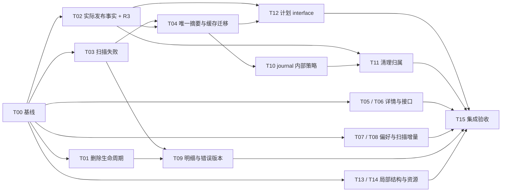

# 功能接口与架构收敛 Implementation Plan

> **For agentic workers:** 后续获得实施授权后，使用 `superpowers:executing-plans`，或用户选择的 `superpowers:subagent-driven-development`，逐项执行。以下 checkbox 只记录未来工作，**本轮不得执行修复**。

**Goal:** 消除已确认的正确性缺口、重复事实与多余 interface；让一个实际功能对应一个权威 implementation，保持已实现的媒体与恢复语义。

**Architecture:** 保留 Electron/React、共享计划器、多盘单次读源和有日志的图库变更。优先归一任务生命周期与实际文件结果，再缩小缓存、状态和计划 interface；不增加通用任务框架、万能文件仓库或第二套复制实现。

**Tech Stack:** TypeScript、Node.js、Electron、React、ExifTool；macOS ImageCaptureCore Swift helper；现有 `node:test`、tsx、Electron QA。

**Spec:** [实际功能、接口与架构审查](../../architecture-and-features.md)，代码基线 `daaabd8`。本文件是可执行计划与选型说明，不表示缺陷已修复。

## Global Constraints

- 不修改用户已有工作；本轮只写文档，不修改业务代码、测试、依赖、全局配置，不提交或推送。
- 继续保留导入 copy、整理 move、去重可恢复变更三种真实业务语义；多个入口汇入同一 implementation。
- 六种布局是同一 `folder/layoutFolders` 的参数，不能借架构修复删掉现有产品选项，也不能各自建执行器。
- 保留文件族分配、同名不覆盖、源/目标身份验证、签名日志与收据、独占发布、恢复与撤销、不同物理盘副本要求。
- `verifyCopies=false` 的新复制不是目标内容已验证；不得授权摘要可信缓存或删除原件。已存在文件若本次内容比较通过，可单独认定已验证。
- 删除源文件仍须重新确认源及所有要求的备份副本。双盘失败不能悄悄变成“一盘成功即可删源”。顺序填盘只要求该文件实际分配的目标槽位。
- 不把 placement/listing 提示当内容证明；不把旧计划当实际发布结果；不把 `action()` 返回当后台完成。
- 旧 journal/receipt 是恢复用户数据的输入，必须保留读取语义；可重建 cache 可以升级后重建。两者不得采用同一种迁移删除政策。
- 每项最终只保留一种实施方案；比较备选不等于同时上线多种实现。没有依据的自动重试、层层 fallback、双写双读永久兼容不进入最终设计。

## Review Focus

1. **晚分配及同尺寸竞争文件**：实际目标进入 Conflicts 后，旧路径外来文件不能得到源 EXIF/SHA/删除资格。由 T02 回归验证。
2. **双盘或文件族部分成功**：按实际成功条目记账，但保留用户要求的全部副本覆盖，不假定 family 原子提交。由 T02 验证。
3. **删除途中停止/退出**：已删、保留和未处理条目必须准确报告，已启动的读取关闭后才释放任务。由 T01 验证。
4. **旧缓存与旧恢复日志同时存在**：旧弱身份 SHA 必须失效；已签名旧 copy journal 必须仍可恢复。由 T04、T10、T11 验证。
5. **异步迟到与原地修改**：旧页面请求不得污染新范围；errors.push/group.count++ 不得绕过状态及错误日志更新。由 T05、T09 验证。

---

## 1. 复核结论与覆盖范围

三个并行任务复核导入扫描、整理恢复、UI/IPC；复用首轮 Grok 的资源、ETA、队列与缓存审查。本轮 Grok 补查触及轮次上限，未产出完整新结论，由主任务直接复核资源计算、placement 调度与 ETA 源码，不将未完成工具输出作为结论。主任务整合并复查关键源码。范围是当前生产功能和已识别问题的静态检查、现有测试基线；不声称覆盖所有硬件、外部并发写入或物理断电组合。

原审查 **8 个 DesktopAPI 方法、7 个 invoke handler、1 个更新事件、50 个 Action** 的枚举仍成立。本计划覆盖 R1–R13，并纳入补查的错误缓存身份、UI 循环依赖、CPU/内存契约及已有测试失败。

复核修正：

- **R12 升为 P1**：晚分配实际路径不回写 TransferPlan，三个完成阶段消费者仍用旧路径；不仅是重复计算。`desktop/core/index.ts:960–984`、`desktop/main.ts:608/627`。
- **R1 增加部分结果问题**：删除目前中止会抛掉已 unlink 的结果；让 Stop 真正生效前，先修记账。`desktop/core/originals.ts:43–80`、`desktop/core/devices.ts:124–134`。
- **R6 包括失效语义**：同 root 新 revision 也应使详情失效；只修 seen 删除不完整。
- **R7 不能直接按对象引用增量化 errors/groups**：它们原地修改，必须先版本化或改写所有消费者。
- **独占复制可跳过回读**：`index.ts:826–830` 在 `verify=false` 时明确跳过目标 digest；原审查中的相反表述已勘误。
- **恢复默认时机**：OrganizeOptions 在排队/生成审核时消费后立即重置，非任务结束时。

## 2. 总体方案选择

| 整体方案 | 优点 | 缺点 | 结论 |
|---|---|---|---|
| 在现有实现上按事实与生命周期收敛 | 保留已验证行为，能逐项交付；修改集中，迁移范围可控 | 仍保留现有较大 main/core 文件，需要明确职责 | **推荐** |
| 按功能搬成少量 deep module，同时替换现有入口 | 最终 locality 更集中 | 同时改业务与结构，恢复/并发验证面扩大 | T12 后按实际需要采用，不作前提 |
| 全面重写任务框架、仓库层、状态总线 | 可统一形式 | 新增协议、迁移、双实现窗口；未消除文件语义复杂度 | 本轮不采用 |

下文列的是当前约束下有实质差异的可行方案；仅换名称、无消费者的抽象不列成选项。每项都给推荐路径，后续可按此直接实施，不必再次设计四五层结构。

## 3. 文件归属与任务顺序

| 任务 | 对应发现 | 修改范围（未来） | 交付 |
|---|---|---|---|
| T00 | 测试基线 | 现有失败测试与验证文档 | 区分代码失败和环境限制 |
| T01 | R1 | `main.ts`、`core/originals.ts`、`shared.ts`、工作状态消费者 | 删除可取消、可等待、保留部分结果 |
| T02 | R12 + R3 | `core/index.ts`、`core/destinations.ts`、main 完成阶段、去重/placement 消费者 | 一个实际结果出口，线性聚合 |
| T03 | R2 | `core/duplicates.ts`、main/renderer 去重结果、消息 | 读取失败可见且不缓存为成功 |
| T04 | R8 + R11 部分 | `core/duplicates.ts`、`destination-index.ts`、相关测试 | SHA 唯一归属、缓存迁移、删无用扫描变体 |
| T05 | R6 | `renderer/DuplicatesPage.tsx`、其私有详情加载实现 | 正确请求生命周期和缓存失效 |
| T06 | R5 | `shared.ts/preload.ts/main.ts/RootApp.tsx`、QA | 文字详情仅一个 interface |
| T07 | R9 | `preferences.ts/shared.ts/settings-lock.ts/main.ts` | 本次选项唯一权威 |
| T08 | R4 | `platform/metadata.ts`、`scan-worker.ts/scan-process.ts`、main | 真正增量路由与精简传输 |
| T09 | R7 + 错误缓存 | `state-channel.ts/job-issues.ts/error-log.ts/main.ts` | 变化版本、稳定明细、准确错误身份 |
| T10 | R11 其余 | `core/recovery.ts/index.ts/destinations.ts`、main | journal 建立一次，策略隐藏内部 |
| T11 | R12 清理部分 | `core/recovery.ts/redundant-folders.ts`、main | 唯一目录清理拥有者 |
| T12 | R10 | `core/index.ts` 计划请求、main Prepared | 小请求 interface、明确审核资格 |
| T13 | R13 + 资源补查 | ETA、队列、有限缓存聚合 | 删无读者状态及无用往返 |
| T14 | UI/资源补查 | UI 共享实现、资源文案/计数 | 消除循环依赖，契约与实现一致 |
| T15 | 全部 | 相关测试、QA、文档 | 集成验收和旧路径清理 |

不为了计划而预建新目录或空文件。仅 T05 若需可控异步测试、T14 的双方共享 UI 确有职责时新增一个私有实现文件；其它优先原地收敛。

T01 与 T02 都改 main，实施时串行；各自不依赖对方的业务算法。T05/T06、T03/T04、T08/T09 各有共享文件，也不能交给两个编辑者同时修改。并行适合只读复核或真正无重叠的工作。

## 4. 逐项修复计划、方案与利弊

### T00：固定测试基线，先解释已有失败

**Files:** 当前测试、`docs/verification.md`；本轮日志位于临时目录，结果见文末。

- [ ] 保存当前 HEAD、工作树差异与基线命令结果；不得把本轮既有文档改动当待清理文件。
- [ ] 对失败测试逐项看断言与环境，必要时单独运行对应文件；只有证据支持才能归因到系统权限或不可用的 hdiutil。
- [ ] 代码回归：修复 owning module；环境不可用：拆开纯文件夹验证与磁盘映像验证，后者在真实能力不足时准确 skip。不能把错误统一 catch 为通过。
- [ ] 每个后续任务只要求“不新增失败且其定向回归通过”；最终全量仍有失败时必须逐项报告，不能声称全绿。

这里没有多个业务实现选项：修正确断言、补真实能力检测和修产品行为是三种不同根因的处理，不能任意互换。

### T01：删除原件进入统一生命周期，并可靠返回部分结果

**Files:** `desktop/core/originals.ts`、`desktop/main.ts`、`desktop/shared.ts`；`settings-lock.ts/keep-awake.ts/eta.ts` 与 `renderer/RootApp.tsx` 的工作状态显示。

| 方案 | 优点 | 代价 / 限制 |
|---|---|---|
| A：原导入 Job 保持终态，登记 deletingOriginals 为活动操作 | 最小 UI 改动，不改变原卡片 | 必须把同一个判定用于 main/Stop/锁/awake/各页，遗漏就仍有两套生命周期 |
| B：独立删除 Job，关联原导入 Job | 与去重/恢复作业一致，phase/取消/退出/锁复用；原导入结果不会被污染 | 需一个真实操作标识/父任务关联及显示迁移 |
| C：统一所有任务的新框架 | 可重设计整体任务模型 | 对当前缺陷范围过大，interface 增长，非本轮推荐 |

**推荐 B。** 独立作业表达一次真实读/删操作，不建立一套独立执行器。若实施希望最小补丁，可选 A，但共享工作状态判定和下述部分结果要求不能省。不得直接把原 Job.phase 改 copying 来伪装删除。

**Interfaces / 不变量：**

- 新删除作业带明确的 `kind:'delete-originals'` 和 `parentJobId`；Job 的新增标识仅用于这项真实操作，其余现有作业形态本轮不迁移。创建作业时直接进入活动 phase，不把它当普通来源导入送回 pump。
- main 内一个具体 `runActiveJob(job,{exclusive},work:(signal:AbortSignal)=>Promise<void>):Promise<void>` 负责登记、取消和 finally；不把业务结果/报告格式塞进该函数。
- 第一次 await 前同步取得活动/排他资格并登记；完成 Promise 纳入 `settling`；Stop/退出只取消这份 controller；exclusive 期间 pump 不启动新的媒体操作。
- `OriginalsResult` 加 `aborted:boolean`、`unprocessed:string[]`；保留 deleted/kept/bytes/errors。已 unlink 后立即记录结果，按输入顺序汇总。
- 取消停止分配新文件；已启动的源/目标读取必须 drain/关闭；unlink 前再检查 signal。预期 Abort 不丢弃结果，不改变通用 mapPool 的抛错契约。
- main 在成功、失败和 stopped 都扣除已删除项并写报告；未处理项不假记为 kept/error。不要加自动重试/恢复。

- [ ] 先写回归：已删 1 项后取消；仍在读的项与未开始项保留；返回/报告数字与磁盘一致。
- [ ] 接上真实 Stop、退出等待、排他资格、设置锁、防休眠和 UI 显示；主进程也拒绝冲突，不仅按钮 disabled。
- [ ] 确认原导入结果、父任务 verifiedOriginals 与删除子任务互相对应；取消后用户再次显式操作可处理剩余项。

**Validation:** 扩展 `source-handling.test.ts`、`parallel-verify.test.ts`、`keep-awake.test.ts`、`settings-lock.test.ts`、`stopping-state.test.ts`；新增 `desktop/tests/originals-lifecycle.test.ts` 检查生产实际使用的生命周期；Electron QA 验证 Stop/退出/自动导入互斥。纯 core 删除测试不能代替 main 生命周期验证。

### T02：实际文件结果唯一出口，同时消除二次方聚合

**Files:** `core/index.ts`、`core/destinations.ts`、main 的 run/recordDuplicates/rememberPlaced/原件候选；`core/duplicates.ts`、`platform/placement-memory.ts`。

| 方案 | 优点 | 代价 / 限制 |
|---|---|---|
| A：扩充并替换现有 onVerified 为 onFileOutcome | 迁移小，成功项可逐个记录；保留现有 Abort 抛错契约 | 发出时机必须统一；回调不得另做耗时异步 I/O |
| B：ExecutionResult 返回 outcomes 数组 | 通过返回值观察最直观，易测试 | 当前 Stop 抛异常会失去普通返回；需额外部分结果契约，且容易形成两份完整数组 |
| C：执行时修改原 TransferPlan 的 destination | 改动表面最小 | 审核对象/签名约束受影响；计划与结果混淆，部分失败难表达 | 

**推荐 A；C 不作最终方案。** 一个 main 集合线性聚合事实，不同时维护 source-only verified 和另一份 outcomes。

**Interfaces:** core 产生内部 `FileOutcome`：`entryId/family/source/sourceIdentity/root/rootIdentity/destination/size/sha256/disposition/verification/finalIdentity`。`disposition` 为 published/existing；`verification` 明确区分 content-verified 与 stream-only。`finalIdentity` 表示收尾后确认的目标身份，不能绑定时不得授权内容缓存。`executeDestinations` 将各照片/视频 plan 的执行 slot 映射为物理 `destinationSlot`，再交 main。类型仅在 core/main；bigint 不进入 renderer，报告时显式转字符串。

- [ ] 回归先制造计划后竞争：原路径被不同内容但同尺寸文件占用，实际发布到 Conflicts；事实只含实际路径，外来文件不得得到源摘要/EXIF。
- [ ] 新发布、确认已有两条分支在最终同步与暂存清理后发出一次事实；hardlink unlink 改 ctime 后重新绑定。校验开启但无法绑定的结果仍不能被标成可信。
- [ ] `verify=false` 新复制只记 stream-only；已存在文件本次确认通过仍可 content-verified；每目标/每条目独立记录，family 较早成员成功、后成员失败必须如实表示。
- [ ] main 按 source 一次构建 Map；去重、placement、原件候选消费同一集合，删除 `for verified → entries.filter`。
- [ ] 原件资格额外对照 allocation 后的 expected target slots：mirror 要求两盘覆盖，sequential 要求分配的一盘；缺任何要求的副本则不授予可删资格，报告原因，不把失败盘旧路径混入实际事实。
- [ ] 删除前仍重新读取源和所有实际目标；事实不是永久删除授权。

**整理晚分配的两种可行处理：**

| 方案 | 优点 | 代价 |
|---|---|---|
| recovery 也在已确认移动/副本后发同类实际事实 | 整理完成即可更新缓存，事实模型一致 | 撤销、resume、旧日志、timestamp/identity 的发出时机验证面大 |
| **先停止用整理旧计划写去重/placement，明确失效后由正常检查重建** | 不会污染缓存，不增加恢复协议，最小正确方案 | 整理后下一次检查更贵 |

第一阶段推荐后者；T10/T11 稳定后若重建成本确实明显，再采用 recovery 事实出口，届时仍只有一个结果协议。不能继续用旧计划“乐观猜测”。

**Validation:** `core.test.ts`、`import-recovery.test.ts`、`destinations.test.ts`、`index-safety.test.ts`、`source-handling.test.ts`、`placement-memory.test.ts`、`duplicates-detection.test.ts`。必测双盘一盘失败、既有副本确认、verify=false、无 bound identity、family 部分发布、整理晚分配。复杂度用计数/规模增长证明线性，不用脆弱毫秒阈值，也不为一个 Map 建通用 module。

### T03：去重扫描失败如实返回，本次每文件最多尝试一次摘要

**Files:** `core/duplicates.ts`、`shared.ts` 的去重状态、main、`DuplicatesPage.tsx/messages.ts/i18n.tsx`。

| 方案 | 优点 | 缺点 |
|---|---|---|
| A：遇任意 metadata/hash 失败即整次失败 | interface 简单，完整性明确 | 单个坏文件丢失其余已完成结果，不符合当前部分处理方式 |
| B：继续处理，返回逐文件 failures 并标扫描不完整 | 保留有效发现，失败可见，下次正常重扫 | 需要结果摘要/报告和 UI 明确呈现未完成项 |

**推荐 B。** `ScanResult` 增加 `failures:{path,step:'metadata'|'hash',error}[]`，主状态仅摘要/受限样例，明细不随进度重发。

- [ ] metadata Promise 成功 resolve 才写 read=true；正常空字段与读取失败明确区分。失败项下次 stat 未变也会重新读取。
- [ ] candidate-first 与 rest 共用 attempted 集合，失败候选不在同次 rest 立刻重试。保留候选阶段进度，不另造 retry 流程。
- [ ] 完成状态区分“结果可用但有未读取项”和“全库已检查”；移除操作仍对所选文件独立确认，不把不完整扫描当全部安全证据。
- [ ] Abort 与普通文件错误分开；错误显示和四语言文本采用现有 Message 系统。

**另一可行摘要算法：** 一个 full hash pass 后统一分组，代码更短、没有重复候选尝试，但改变阶段一优先反馈与导入候选复用；本轮推荐保留 candidate-first，只消除重复尝试。

**Validation:** `duplicates-detection.test.ts/scan-concurrency.test.ts/duplicates-ui.test.ts`；首读抛错→同 stat 重扫成功恢复分组；失败候选本次只调用摘要一次；有效空 EXIF 可缓存；失败统计、Abort、部分有效结果均可观察。

### T04：摘要可信规则只归 DestinationIndex，升级可重建缓存

**Files:** `core/duplicates.ts/destination-index.ts/paths.ts`，缓存相关测试。

| 方案 | 优点 | 缺点 |
|---|---|---|
| A：两份 store 继续持有 SHA，共用 stat helper | 修改少，规则短期一致 | 摘要仍双写、双迁移、双失效，没有消除事实重复 |
| B：DuplicateStore 只保留元数据，摘要一律经 DestinationIndex | 消除第二个摘要拥有者；沿用已有深 module | 老记录需重建一次；元数据身份也须补完整 |
| C：合并全部缓存到一个 repository/数据库 | 可统一存取 | 迁移/事务/依赖成本大，不同信任语义并不会消失 |

**推荐 B。** DestinationIndex 保留现有持久摘要格式与 FAT-like 信任策略；DuplicateStore 采用新版本，仅保存实际需要的 fingerprint/edited/读取状态与完整身份。

- [ ] 删除 `asFile` 从 DuplicateStore 带入旧 SHA 的路径；scan 内容摘要只经 DestinationIndex。
- [ ] 元数据缓存使用已有完整 stat 规则，不继续只比较 size/mtime/ino；不可证明身份时正常重读，不引入新的可信兜底。
- [ ] v2 缺少充分身份字段，首次忽略并重建。不得将 v2 SHA 导入权威 index，不迁移到“可信”标记。新文件仍原子写入；无需主动清理用户目录中的其它文件。
- [ ] 删除无产品调用者的 recorded/folders 扫描变体、restore、持久 groups/complete/updated；确认所有消费者和测试后统一移除。未来若真的增加子目录去重，再作为真实需求设计。
- [ ] 由 T02 的实际事实记录元数据到真正目标；不按旧计划路径追加。

**Validation:** `duplicates-detection.test.ts`、`index-safety.test.ts`、`visible-app-files.test.ts`。必测伪造旧 SHA 不采纳、size/mtime/ino 相同但 ctime 改变、FAT-like 重新读取、可靠 stat 的二次扫描命中、损坏缓存正常重建。只改缓存结构镜像断言，不删除媒体内容/恢复安全测试。

### T05：去重详情请求与显示缓存一致

**Files:** `renderer/DuplicatesPage.tsx`；若现有测试无法运行 effect，仅新增一个实际被 UI 调用的 `renderer/duplicate-details.ts` 私有加载实现。

| 方案 | 优点 | 缺点 |
|---|---|---|
| A：root+revision 为 generation，成功结果与 in-flight 分开 | 无新增 IPC，重扫失效明确，翻页可复用 | 重扫后即使未变也会重读当前页 |
| B：root+文件完整 identity 跨 revision 复用 | 未变文件少读 EXIF/图片 | 当前详情字段未必具备完整身份，键和旧数据处理更复杂 |
| C：每次翻页完全清缓存 | 逻辑最短，不会卡 seen | 来回翻页重复读取，浪费明显 |
| D：后端批量详情及统一缓存 | 多消费者时可共享 | 当前需求不足，新增协议和缓存拥有者 |

**推荐 A。** 不增加自动 watcher，不承诺扫描后外部修改文件能实时更新。

- [ ] generation = root+duplicates.revision，首次渲染只读对应 generation 的缓存，不能等 effect 清理后才隐藏旧 root 同名图片。
- [ ] 成功缓存与在途请求分开；旧 generation 结果不得覆盖新结果，旧 finally 不得解除新请求的在途标记。
- [ ] thumbnail 与 EXIF 单独记录 success/error；一个失败不覆盖另一个成功。增加显式重试失败项的入口；不做自动无限重试。
- [ ] 保留现有最多 3 个文件并发、每文件两个读取并行。同轮翻页复用；可设仅保留最近页的有界缓存，是否需要由当前页图片占用测量决定，不先做全局 LRU。

**Validation:** 新增 `desktop/tests/duplicate-details.test.ts` 用可控 Promise 验证生产加载实现；Electron QA 补真实翻页。场景 A→B→A、root/revision 同名路径切换、迟到结果、StrictMode setup/cleanup/setup、卸载、单项失败重试与并发上限。SSR 的 `duplicates-ui.test.ts` 单独不足以证明 effect 正确。

### T06：文字 EXIF 一个 interface，图片仍按需

**Files:** `shared.ts/preload.ts/main.ts`、`renderer/RootApp.tsx`、`qa/codex-smoke.ts` 与所有 inspect 调用。

| 方案 | 优点 | 缺点 |
|---|---|---|
| A：文字统一 exif，删除 inspect | 少一个公开方法和通道，直接去掉无用 preview | 需一次迁移所有调用；同包发布无需永久兼容 |
| B：inspect 改 preview:false，保留同义方法 | 补丁最小 | 没有完成 interface 收敛，只能作为临时补丁 |
| C：details(path,options) 组合图片与 EXIF | 一个入口，可选读取内容 | 当前两个需求独立，选项与缓存组合增加 |

**推荐 A。**

- [ ] renderer/QA 文字调用统一 exif；删 DesktopAPI/preload/main 的 inspect 声明和 handler。
- [ ] 保持完整 EXIF、时区、快门数、错误语义；thumbnail 继续按需调用。
- [ ] 全仓核对 metadata.preview/preview 参数的真实消费者后，仅删除无消费者分支；embeddedPreview 仍供 thumbnail 使用，不能连带删掉。

**Validation:** `metadata-extraction.test.ts/editor-metadata.test.ts/metadata-display.test.ts/duplicates-preview.test.ts/i18n.test.ts`；文字详情不得调用图片提取；缩略图仍有效；核对迁移后 DesktopAPI/handler 数目和残留字符串。

### T07：本次整理选项唯一权威

**Files:** `preferences.ts/shared.ts/settings-lock.ts/main.ts`；保留 `run-policy.SourcePolicy` 的实际执行字段。

| 方案 | 优点 | 缺点 |
|---|---|---|
| A：移除失效持久偏好，旧设置读入时忽略 | 当前行为不变；消除假入口 | 旧 round-trip 类型/测试要更新 |
| B：保留只读 deprecated 字段 | 改动小 | 仍向调用者暴露无效 interface |
| C：让旧持久偏好重新决定本次默认 | 偏好重新有意义 | 改变当前“每次默认开启”的产品行为，不是等价修复 |

**推荐 A。**

- [ ] 删除 Preferences/default/normalize/锁名单中的 `removeEmptySourceFolders/releaseDuplicatesAfterOrganizing`；不删除 SourcePolicy 内真实字段。
- [ ] 继续由 OrganizeOptions 控制；排队或生成审核时冻结并立即重置；选/重置目录也重置。
- [ ] 删 main 未使用 livePreferences，保留 settings-lock 的唯一集合；统一已有 active phase 常量，避免新增第二套权限规则。

**Validation:** `preferences.test.ts/source-handling.test.ts/settings-lock.test.ts/organization-release-duplicates.test.ts`；旧设置不能把 import 变 move；本次显式关闭有效；审核冻结；默认重置时机正确。删除无用常量不单独新增测试。

### T08：扫描增量直接产生，不再全表寻找

**Files:** `platform/metadata.ts/scan-worker.ts/scan-process.ts/main.ts`。

| 方案 | 优点 | 缺点 |
|---|---|---|
| A：metadata 内 worker 专用 learned Map，take 后清空 | locality 集中，不再复制全缓存 | 必须区分本地新读、seed、hit，限定仅 worker 启用 |
| B：metadata 读取接受 onLearned 回调 | 依赖显式，没有全局待发队列 | 批处理/缓存知识进入调用者，接口更宽 |
| C：递增序号日志+cursor | 可服务多个消费者 | 多消费者并不存在，需截断/回收协议；不能借 LRU 顺序当新增游标 |

**推荐 A。** learned 捕获只在扫描 worker 启用，main 不保留一份永不 drain 的第二路由缓存。

- [ ] 新内部 interface：`beginRoutingCapture():{take():[string,Metadata][];close():void}`，扫描 worker 持有一个 capture，take 后清空。仅捕获启用期间本地真实读取得到的新 stat-key；primeRouting/命中/recall 的 LRU touch 不入队。不建多订阅者事件系统。
- [ ] pending Map 按 key 去重；每秒 flush、正常结束和停止/失败前 flush 后清空；关闭捕获释放待发条目，避免泄漏。
- [ ] 增加 `routingEntriesUnder(root)`，在 module 内迭代筛选，避免 main 先复制所有来源再 filter。
- [ ] 保留跨进程接收后的所有权隔离。跨进程 transport 已 clone 是否还需 primeRouting 的逐条 structuredClone，要以“对象不再被调用者修改”证明后再删，不能盲删保护。

**完整 Inventory 往返的可选收敛：**

| 方案 | 优点 | 代价 |
|---|---|---|
| 保持当前结构 | 无协议改动 | 初始 reuse 含不需要的字段 |
| 私有 reuse DTO：relative/size/folders/必要身份 | 少传绝对路径、分类等可导出数据 | 需单一编解码和重挂载验证；最终 UI 清单仍需一次返回 |
| renderer 明细分页后端读取 | 显著减少前端常驻清单 | 新增列表/过滤/分页协议，当前未证明需要 |

先量 1 次大清单消息字节、编解码时间与父子 RSS；DTO 若有显著占用再做，不作为 learned queue 修复前提。不要删除扫描 utility process 隔离。

**Validation:** `routing-cache.test.ts/metadata-batching.test.ts/scan-memory.test.ts/scan-progress.test.ts`；seed/hit 不发送、新 stat 发一次、第二次 drain 空、LRU touch 不破坏增量、取消保留已读增量。DTO 另验重挂载路径与 invalid listing 不能复用。

### T09：稳定明细按真实变化发送，错误缓存使用同一事实

**Files:** `state-channel.ts/job-issues.ts/error-log.ts/main.ts/shared.ts` 及相应 renderer 接收。

| 方案 | 优点 | 缺点 |
|---|---|---|
| A：集中变更点与显式明细版本，变化时生成一次快照 | 保留 O(1) 追加；不变进度不重传；可复用给错误缓存 | 漏一个写入点会静默陈旧，需完整写点清单 |
| B：全部不可变替换后按引用发送 | 引用规则直观 | 大 errors 数组逐次复制可能 O(n²)，修改面大 |
| C：每次 emit 比较/序列化内容 | 不改写点，容易保证对齐 | 仍全表遍历，只省传输，没有消除计算 |
| D：批量明细全改按需接口 | payload 小 | 新增 interface、失效和加载时序；未必比已有版本策略简单 |

**推荐 A，先覆盖实际大字段。** 不把所有 AppState 改通用 patch。

**Interfaces / 协议：**

- `job-issues` 与 main 的错误/问题文件/排除列表写入集中到少量现有职责内的更新函数，推进私有 `detailsVersion`；不把多份重复计数当来源。
- 状态用 `jobDetails` 的版本引用传稳定快照；Job 的 phase/progress/计数仍直接传。group.count 高频变化和样例路径分开，避免每个 count++ 重传全部路径。
- ErrorLog 缓存改用同一真实错误变更版本，覆盖原地 push、等长替换、code/severity 变化、来源显示名、确认/清除。不能只用数量指纹。
- reset 必须自包含；省略字段表示保留，null 表示清除；receiver 先验证临时结构再原子提交，缺引用不能清空旧缓存后抛错。
- 保留旧 revision 丢弃和初始 snapshot 在途事件；revision **允许跳号**，snapshot 查询也递增。不能用 revision+1 判丢包。
- 维持当前可靠有序 IPC 假设，非法引用按明确协议错误处理；不新增无证据的自动 resnapshot 重试。若将来需要丢事件恢复，另设计发布基准序列，而非猜 revision 连续。

- [ ] 先枚举 `errors/groups/problemFiles/excluded/sourceCameraInfo.issues` 等写点；分别标出可原地修改和可不可变替换的拥有者。
- [ ] 引入版本和快照后，再启用增量发送；不得先按 WeakMap 去重可变数组。
- [ ] ErrorLog 等长 A→B 替换正确更新时间/清除身份；B→A 返回时 A 不沿用已失效隐藏状态。
- [ ] 记录 progress-only 消息：未变明细不再出现；版本仅按实际写点改变，不在每次 emit 盲增。

**错误缓存的其它可行方案：** 完整稳定错误 ID 指纹可单独修正确性，改动小但每次仍 gather/hash；每次无缓存重建最简单但大错误组成本高。若 T09 拆阶段，可先用稳定 ID 指纹纠正行为，再统一版本；最终不要长期维护两种身份推断。

**Validation:** `state-channel.test.ts/error-log.test.ts/error-groups.test.ts/error-severity.test.ts/acknowledge.test.ts`。必测原地 push/count++、等长替换、纯进度不重传、不变对象复用、reset、Job 淘汰/重新出现、旧消息、snapshot 不吞更新、缺引用不污染旧状态，wire 必须经过 structuredClone。性能记录实际消息字节；不以固定壁钟时间作通用门槛。

**Action 返回语义：** 推荐保持 void，状态反映后台完成。`ActionResult {accepted,error?,jobId?}` 也可行，优点是立即拒绝可见，代价是 50 个动作的明确协议迁移；没有新调用者需求时不与本次合并。无论选哪一种，accepted 都不是 completed。

### T10：journal 建立归一，新整理策略收回内部

**Files:** `core/recovery.ts/index.ts/destinations.ts`、main。

| 方案 | 优点 | 缺点 |
|---|---|---|
| A：两个业务入口共用私有 createJournal | 认证、身份、签名持久化只有一处；保留清晰业务入口 | 需回归两种 manifest 与异常清理 |
| B：合成公开 runMutation(kind,大量 options) | 形式统一 | 调用者学习内部细节，易退化成宽 interface |
| C：保留两个入口及重复建立代码 | 最少修改 | 后续修日志持久化仍两处维护 |

**推荐 A。** 私有 `createJournal(spec,entries):Promise<Manifest>` 只负责认证/roots、祖先身份、manifest 验证、目录建立和签名同步；业务入口分别决定 kind/source/keepFolders 等真实值，继续调用既有 run。

- [ ] `beginOrganization` 与 `beginDuplicateRemoval` 改用同一私有建立 implementation；两者返回 id/自动 release 的业务差异保留。
- [ ] 新组织固定 rename，把公开 strategy 从 main→destinations→index 的生产请求移除。
- [ ] copy/stash 继续作为真实情况的内部处理；旧 manifest 无 strategy 继续按旧 copy 语义读取，不能重写已签名原 manifest。
- [ ] 旧 copy 恢复测试改用旧日志 fixture，不为测试保留新的公开产品策略；保留 EXDEV、空文件、已有同内容目标路径覆盖。

**Validation:** `recovery.test.ts/organization-rename.test.ts/recovery-remount.test.ts/organization-supersession.test.ts/handoff.test.ts/organization-release-duplicates.test.ts/journal-compaction.test.ts/process-crash.test.ts`；跨步骤中断后只恢复本 journal 的文件，旧日志签名及解释不变。

### T11：目录清理一个拥有者，范围随 journal 固定

**Files:** `core/recovery.ts/redundant-folders.ts`、main。

| 方案 | 优点 | 缺点 |
|---|---|---|
| A：保留 recovery empty cleanup + main service-only sweep | 风险小，语义都在 | 同一功能两处编排，resume 与初次完成可能不同 |
| B：recovery 统一拥有明确 scope 的目录清理 | 新建/继续行为一致，main 只消费计数 | 需签名范围、旧日志缺省解释与验证 |
| C：只删一段清理 | 代码最少 | 会丢 service-only 或祖先 empty 语义，不是等价方案 |

**推荐 B；C 不采用。**

- [ ] 新 journal 记录最小 cleanupScope：选定来源目录与必须保留的照片/视频根；签名前验证包含关系、祖先身份。不是默认 whole source tree。
- [ ] 只有 clean mutation 完成后按已确认范围清理；error/abort 不扩大清理；用户文件、符号链接、恢复目录始终保留。
- [ ] 旧 journal 缺 scope 时沿用原来的祖先 empty-only 语义；不凭当前偏好扩大旧任务范围。
- [ ] main 删除第二次清理编排，消费 recovery 的 foldersRemoved；helper 可以留在 redundant-folders，但只有 recovery 决定何时、何范围运行。

**Validation:** `redundant-folders.test.ts/recovery.test.ts/media-layout.test.ts`；只选目录、service-only、未知用户文件、双根保护、keepSourceFolders、取消/错误、resume、旧日志缺字段。

### T12：计划 interface 缩小，审核权限明确

**Files:** `core/index.ts`、main 的 prepare/Prepared/review。

| 方案 | 优点 | 缺点 |
|---|---|---|
| A：现有 plan 内部仍共享，外部请求按真实意图区分 | 去掉无效布尔组合，迁移可局部完成 | 仍需内部约束转换；类型更清楚但不自动减内存 |
| B：opaque Prepared 持有执行资格，UI 仅拿只读 view | 审核对象与权限集中，调用者无需知道 WeakMap | main 预留/报告/恢复接口迁移较大 |
| C：按扫描/路由/分配/执行各加公开层 | 名称和文件表面整齐 | 参数层层传递，未增加 depth，正是本次要避免的拆分 |

**推荐先 A，B 仅在消费者迁移后采用。** 真实意图是媒体导入、整盘备份、整理、错位只读检查；可以是一个 discriminated request union，也可以是已有少量语义明确入口，内部只走一次 planOnce，不是四个 implementation。

- [ ] T02/T04 后复查调用者是否仍需宽 Options；对照真实生产调用移除不合法组合与无消费者选项。
- [ ] 保留普通导入对合法 serialized plan 的现有支持；整理与镜像 removals 继续要求可信的进程内审核资格。
- [ ] 若选 B，用私有 token/对象身份绑定与未变字段检查，不能用调用者可构造的 JSON brand 替代权限；保持 discard 释放预留和相机暂存。
- [ ] 不为了这个任务强改全批次为流式计划。文件族、内容冲突、双盘容量需要批次知识。

**Validation:** `planning.test.ts/allocation.test.ts/import-recovery.test.ts/drive-backup.test.ts/organize-backup.test.ts`；序列化普通计划可执行、伪造/更改整理或镜像审核拒绝、过期 root/源身份拒绝、应用审核不重新走独立路由。B 的迁移收益不足则记录保留 A，不留下两条兼容执行链。

### T13：ETA、队列与小缓存的局部简化

**Files:** `eta.ts/eta-format.ts/eta-model.ts/queue-order.ts`、main；必要时 listing/scan memory 的调用点。

| 范围与方案 | 优点 | 代价 / 推荐 |
|---|---|---|
| 删 Legacy.smoother、JobState.known、未用 remainingRange 等无读者状态 | 复杂度直接消失，不改行为 | **直接推荐**，不新增镜像测试 |
| 显示平滑和分桶保持合成一处 | 上跳/保持规则一个拥有者 | 推荐最终方向，但先列出已有规则与 fake-clock 结果，不能当两者完全相同 |
| 保留 EtaSmoother + DisplayHold 的不同职责 | 风险低，现有行为不变 | 可行，若合并收益小就保留；仍删死状态 |
| 强行用 JobModel 替代 listing/未知总量 estimator | 模型形式统一 | 不推荐：膝点、未知总量和上限语义不能直接删除 |
| 内部排序返回 Job，发 UI 才 map id | 去掉 ids→find，保持一个排序规则 | **推荐**；删无产品消费者 nextQueued，保留 nextRunnable |
| 所有范围都共用 scan-memory，删 listing-memory | 文件更少 | 不可等价：文件夹/相机/子范围身份不同 |
| 相同卷/全卡 scope 直接从已有 scan 列表算数量，特殊 scope 保留 listing hint | 少存一份同范围聚合 | 可行但收益小，已有列表在手才复用；不能为省两数字重新读完整扫描文件 |

- [ ] 删除确定无读者项，保留既有行为回归。
- [ ] 排序 implementation 一次返回任务对象，main 的 state.queueOrder 仅在发送时取 id；不再找回对象。
- [ ] ETA 合并仅保留一份显示状态机，fake clock 逐项验证完成归零、停滞增时、上跳保持、分桶、未知总量；不能再叠第四层平滑。
- [ ] 如多个 estimator/RateMeter 要共用采样，先证明采样语义一致；速度与剩余时间不同时间常数本身不构成错误。

**Validation:** `queue-order.test.ts/eta.test.ts/eta-hold.test.ts/eta-display.test.ts/eta-tracker.test.ts/eta-model.test.ts/eta-priors.test.ts/listing-eta-ui.test.ts`。删除状态不新增测试；有行为变化才补 fake-clock 回归。

### T14：真实共享 UI 与资源契约

**Files:** `renderer/RootApp.tsx/DuplicatesPage.tsx`；`resource-limits.ts/threadpool.ts`、性能设置文案与四语言目录。

**UI 循环依赖：**

| 方案 | 优点 | 缺点 |
|---|---|---|
| A：把双方真实共用的 Button/CardHeader/确认/进度等搬到一个小 UI module | 唯一实现，无 RootApp↔DuplicatesPage 循环，locality 清晰 | 需迁移 import 与测试路径 |
| B：RootApp 把需要的展示函数作为 props 传入 | 不新增文件 | props 变宽，双方仍需知道展示细节 |
| C：保留循环 | 无改动 | 可运行但维护不清；不是已证实 P1 |

推荐 A；不为每个图标/小函数建一个文件，不保留旧实现再包转发。

**CPU/内存：需选定承诺，不能混写。** 当前 cpuWorkers 分别限制 hash/ExifTool/thumbnail，每个 scan worker 又有自己一份 limits；UV 是另一组 I/O 线程。`resourceUse.threads` 是配置值，不是实际总活跃线程。内存 governor 计 main RSS+Electron Utility 工作集，不是所有 renderer/原生辅助进程总量；scan heap 至少 1GB，内存预算最小 512MB，不能承诺硬上限。

| 方案 | 优点 | 缺点 |
|---|---|---|
| A：保留每池上限/软预算，精确改文案、读数名称与说明 | 实现真实，简单，不引入跨进程调度 | 不提供“全应用总 CPU≤N”的保证 |
| B：一个全局 CPU token budget，进程申请配额 | 能近似约束各可控池总并发 | ExifTool/系统 decoder 内部线程不可完全控制；通信/退出/等待复杂 |
| C：静态分配各池 quota，总和不超 N | 比全局 token 简单 | 小预算时串行和闲置明显，多扫描进程仍需总数分配 |

**推荐 A，保持现有设置行为。** 若用户实际需要总量控制，B/C 是产品规格变更，另设明确任务；不能把 A 的数字称“最多使用的总处理器数”。不把软内存预算改成越界终止任务。线程池必须在首次 libuv 使用前设置，合并常量不能改变初始化时机。

- [ ] 本地复核各进程计数范围和 UI 文案，区分“配置上限”“实测用量”；四语言同步。
- [ ] 保留 CPU/内存默认公式和现有软预算行为，仅删除未用 helper/重复常量等确定冗余。
- [ ] UI 提取保持 CSS/testid/动画与 reduced-motion 行为，避免同时重新设计样式。

**Validation:** `performance-settings.test.ts/resource-limits.test.ts/resource-enforcement.test.ts/threadpool.test.ts/duplicates-ui.test.ts/titlebar-pages.test.ts/motion.test.ts`；更名/说明不新增实现镜像测试。

### T15：集成验收、迁移清理与文档同步

- [ ] 每个任务先运行其定向测试和 `npm run typecheck`；没有变更不重复全套。
- [ ] 相关任务完成后 `npm test` 和 `npm run build`；所有失败按 T00 对照归因，保留完整日志。
- [ ] `npm run codex:test -- --no-build` 只用隔离 fixture/userData 验证导入、审核、整理、恢复、删除取消和详情翻页；不对真实媒体执行删除。
- [ ] 缓存旧版本重建、旧签名日志 resume/undo/finalize、verify=false、双目标部分失败、同尺寸竞争路径、停止部分结果全部通过。
- [ ] R7/R8/DTO 等性能项只跑一次有代表性的确定规模实验，记录消息字节、读取次数、峰值 RSS、阶段耗时；压力测试按变更选择，不笼统要求每次全量硬件测试。
- [ ] 主入口与测试消费者迁入新路径后，删除旧通道、无用 options、死状态与重复收尾。不要保留 new/legacy 实现让调用者选择。
- [ ] 更新架构文档、接口数量、默认值、验证记录；无 source-only verified/旧计划猜测/失效偏好残留。只读历史 journal 的必要兼容保留在当前 implementation 内。

## 5. 仍有成本但不应先重写的部分

| 项目 | 可行方案与利弊 | 本计划决定 / 触发条件 |
|---|---|---|
| 全批次多份数组/Map | 共享内部 source table+目标 assignment 可减内存，但要重做索引拥有者；直接流式计划省驻留，却使族、冲突与空间更复杂 | 先测持有者与峰值；只在占用显著时共享内部表，不新建公开层 |
| 慢目标反压 | 现状串行写各目标，内存有界；每块并行写可减少串行等待；独立目标队列提高隔离，但增加缓冲/取消/背压政策 | 保留一读多写。实测慢盘明显拖累且用户需要隔离时，优先有限每块并行，不先做无限队列 |
| hash chunk 复制 | 本地 hash 无消息复制但占主线程；当前 worker copy 后 transfer 主线程更轻；共享 buffer 需生命周期协议 | 保留当前正确复用约束。CPU/GC 成为实测瓶颈才改；不能 transfer 仍将复用的源 buffer |
| 相机全部本地暂存 | 共用 filesystem 核心，简单且恢复路径一致；catalog+按需下载省空间，但引入设备会话与元数据获取协议；相机专用执行引擎重复核心 | 保留。只有实际空间/等待成为产品问题时改按需 adapter，不增加第二套复制器 |
| thumbnail 磁盘 prune / UI 多页缓存 | 当前磁盘 prune 每 25 次遍历目录；增量索引可少扫但多状态；UI 有界最近页缓存可降驻留 | 先量真实大小与频率；无明显问题不加索引/缓存管理层 |
| placement 检查与导入写入竞争 | 读改写事务或同一队列覆盖读取到替换可防覆盖，但会扩大锁范围；只在提交前检查 generation/abort 可拒绝陈旧结果，改动更小 | main 的 pump 会 abort 检查，placementWork/writing 又串行收尾；未建立可重现丢更新顺序，暂不列已确认缺陷。后续用可控 Promise 固定交错证明，复现后优先拒绝陈旧提交，不先造通用锁 |
| Windows/Linux 原生能力差异 | 新平台 adapter 可补协议相机/系统缩略图；完全统一实现会掩盖平台能力 | 当前架构修复不扩大平台功能；文档说明实际支持和未实机验证范围 |

这些项目都已纳入检查与决策，不以“以后优化”掩盖确定 bug；也不把所有可想象性能改造变成必须实施的任务。

## 6. 验收矩阵与删除旧路径条件

| 要求 | 完成证据 | 旧路径可删除条件 |
|---|---|---|
| 一个功能一个实现 | UI/IPC/core 调用清单与残留搜索 | 所有真实消费者已迁移，非只删 export |
| 原件删除可管理 | Stop/退出/锁/awake 与部分结果端到端通过 | 旧局部 controller 与独立未追踪 Promise 移除 |
| 实际事实正确 | 晚分配/外来同尺寸/双盘部分失败回归 | 普通导入不再从旧计划写内容事实或删除候选；整理在未提供结果事实前明确失效缓存 |
| 去重不丢失败 | 同 stat 重扫恢复、无立即重复 hash | read:true 不再由异常路径写入 |
| 唯一摘要信任 | 旧缓存伪 SHA、ctime 变更、FAT-like 回归 | DuplicateStore 不再保存/返回 SHA |
| 详情不陈旧 | 快速翻页、root/revision 切换、迟到、显式重试 | seen 不再同时承担 loaded/in-flight |
| IPC 真增量 | 不变明细字节、原地变更版本、reset/顺序测试 | 旧计数指纹与重复稳定明细映射移除 |
| 恢复能力保留 | 旧 copy/新 rename/去重日志恢复链测试 | 只删新请求的冗余策略，不删历史读语义 |
| 性能结论有依据 | 线性计数、消息字节与代表规模 profile | 不因代码更短宣称吞吐已提高 |

## 7. 本轮基线与未执行事项

本节记录的是**修复前**检查，不是修复验收。所有 T00–T15 checkbox 保持未勾选。

- `npm run typecheck`：通过，退出码 0。
- `npm test`：退出码 **1**；共 **1202** 项，**1174 通过、3 失败、25 跳过、0 取消**；耗时约 **203 秒**。

| 修复前失败 | 实际失败位置 / 输出 | 归类与后续处理 |
|---|---|---|
| `edge-filesystems.test.ts`：read-only destination folder or volume | 第 89–90 行磁盘映像返回 undefined，`assert.ok(mount)` 失败；此前普通只读文件夹断言已执行通过 | 当前运行未取得映像挂载点。把普通文件夹与映像验证拆开，实际能力不足明确 skip；可用环境仍必须验证只读卷 |
| `folder-drives.test.ts`：folders chosen together are grouped by the drive | `hdiutil create ... HFS+ ... DRVONE.dmg` 退出码 1，stdout/stderr 均为空 | 失败发生在测试前置映像创建，尚未验证产品分组断言；记录环境能力缺口，不能声称功能失败或已通过 |
| `folder-drives.test.ts`：folder inside the backup is rejected | `hdiutil create ... HFS+ ... DRVBACKUP.dmg` 退出码 1，stdout/stderr 均为空 | 同上；适当分离可用纯临时文件夹验证与需要真实卷身份的集成验证 |

没有进一步提升权限重跑这些磁盘映像测试，也未确定系统拒绝的具体原因。25 个 skip 含环境/平台条件，不能统称全部是 hdiutil；本轮不修改测试使其变绿。以上基线不妨碍已由源码确认的 R1/R2/R6/R12 问题成立。
- 未运行真实卡/相机/双物理盘、Windows/Linux 实机、物理断电测试；没有执行本计划中的修复或新回归测试。
- 临时日志：`/tmp/photo-architecture-review/typecheck-plan.log`、`/tmp/photo-architecture-review/tests-plan.log`。
- 本轮最终核对生产源码/现有测试/构建配置的内容哈希及 Git 差异，确保只改文档。日志与本轮 Grok 复核在临时目录，不是产品文件。

## 8. 计划执行边界

推荐路径已足够明确，可按依赖顺序实施；各表中的替代方案只用于比较，不同时实现。范围最大的选择是删除任务形态、结果回调/返回值、缓存可信归属、状态版本策略与 Prepared 权限收敛。本文已经给出推荐及代价，后续选择不同方案时应更新对应任务及验证，而非并排保留两个实现。

本次交付到计划为止；不进入实施、不自动提交、不创建 issue、不触发真实媒体写入。

## 9. 与 deep-interfaces 计划合并后的执行顺序（2026-10-23 09:50 复核）

本节合并本文（记作 R-Tn）与 [deep-interfaces](2026-10-23-deep-interfaces.md)（记作 D-Tn）。依据是集成分支 `claude/architecture-review-4@66735bb` 的源码。该分支已包含 main@5a0aa01、architecture-review-4 和 verify-once。仍未合并的有：records-v5、exfat-copy-path、live-defects、exfat-empty-files、ui-test-sequence。两份计划里同一功能只保留一个任务和一种实现。

### 9.1 已被其他分支修复或部分修复

| 项 | 状态 | 证据 | 剩余 |
|---|---|---|---|
| R-T01 删除原件 | 大部分已修 | review-4：`originalsControls`，Stop/退出/idle/保持唤醒；`OriginalsResult.stopped`，未处理项记为 `kept:'stopped'` | 只补 main 生命周期测试。独立子任务（原方案 B）不再需要：现有登记已覆盖取消、等待、锁，再拆一个 Job 是新增形态 |
| R-T02 二次方聚合 | 已修 | review-4 F6 | 晚分配与外来同尺寸文件的事实问题仍在，见 9.2 的 A2 |
| R-T02 stream-only 标记 | 部分 | verify-once：`onVerified(...,streamed)` | 要并入 A2 的结果出口 |
| R-T03 失败记成 read:true | 已修 | review-4 F5 | failures 列表、本次只尝试一次摘要 |
| R-T04 去重摘要来源 | 部分 | verify-once：去重时从库索引取摘要 | DuplicateStore 仍存 SHA；records-v5 改缓存格式 |
| R-T05 详情缓存 | 部分 | review-4 F9：已加载与在途分开 | root+revision 失效、单项失败重试 |
| R-T06 / D-T9.3 inspect | 已修 | review-4 P5 | 无 |
| R-T07 | 部分 | review-4 删除 `livePreferences` | 两个失效持久偏好 |
| R-T09 | 部分 | review-4 P1：状态通道引用表；errors 按长度做版本（只追加） | ErrorLog 计数指纹、group.count++ |
| R-T13 | 部分 | review-4 删除 `Legacy.smoother`、`JobState.known`、`nextQueued` | `remainingRange` 只删 `eta.ts` 中的未用 import，渲染仍在使用 |
| D-T1 idle | 已修 | review-4 F1：`!recoveryRefresh.running` | 两个中止控制器的收敛（低优先） |
| D-T4 token 表 | 部分 | review-4 A8：`folder-template.ts` | `rulesScope`、`libraryRoots`、`validateRelative` |
| D-T8 组织 copy 多次读 | 大部分已修 | verify-once：流哈希、链接 stage、stat 绑定 stash | 导入独占复制的目的地回读、密封函数迁移，等 records-v5 后复核 |

已核实仍然存在：`main.ts:667` 写死 `strategy:'rename'`，`recovery.ts:1011` 的缺省值仍是 `'copy'`（D-T2）。level 3 自动处理 `exif` 组（`duplicate-rules.ts` 的 `automatic`），删除循环只对 `sha` 组比对字节（`duplicate-removal.ts:91`）（D-T3）。

### 9.2 合并后的任务（每项一个实现）

| 编号 | 内容 | 来源 | 前置 | 共享文件，不可并行 |
|---|---|---|---|---|
| A1 | 先分盘再算路径 | D-T5 | 无 | `allocation.ts`、`core/index.ts` |
| A2 | 实际结果出口 `onFileOutcome`，覆盖晚分配、预检已存在、routed、exFAT 直写 | R-T02 | A1，exfat-copy-path 合并 | `core/index.ts`、`main.ts` |
| A3 | 唯一摘要拥有者 + 扫描失败 + level 3 认字节 | R-T03、R-T04、D-T3 | records-v5 合并 | `duplicates.ts`、`duplicate-rules.ts`、`duplicate-removal.ts` |
| A4 | journal 建立归一、strategy 缺省值、唯一目录清理拥有者、`._` 只经 `inspectAppleDouble` | R-T10、R-T11、D-T2、D-T11.1 | records-v5 合并 | `recovery.ts`、`redundant-folders.ts` |
| A5 | 一条目录规则与 scope | D-T4 剩余 | 无 | `folder-template.ts`、placement/routing memory |
| A6 | 清单 reuse 记录 + 扫描增量 | D-T7、R-T08 | live-defects 合并（metadata.ts） | `inventory.ts`、`scan-*.ts`、`metadata.ts` |
| A7 | 卷快照与稳定 id | D-T6 | exfat-copy-path、live-defects 合并（devices.ts） | `volumes.ts`、`devices.ts`、`device-selection.ts` |
| A8 | 元数据单一解释器 | D-T9 剩余 | live-defects 合并 | `metadata.ts`、`file-timestamps.ts` |
| A9 | 错误身份在记录时算一次，ErrorLog 用同一版本 | R-T09、D-T10.3 | 无 | `error-log.ts`、`job-issues.ts`、`error-groups.ts` |
| A10 | ETA 单一估计器与显示状态 | D-T10.1-2、R-T13 剩余 | live-defects 合并（eta.ts） | `eta*.ts` |
| A11 | 去重详情生命周期 | R-T05 剩余 | 无 | `DuplicatesPage.tsx` |
| A12 | 失效偏好、设置常量、资源文案 | R-T07、D-T10.6、R-T14 资源文案 | 无 | `preferences.ts`、`settings-lock.ts`、`shared.ts` |
| A13 | 共享 UI module，消除 RootApp↔DuplicatesPage 循环依赖 | R-T14 | A11、所有 renderer 分支合并 | `RootApp.tsx`、`DuplicatesPage.tsx` |
| A14 | 残留计数分开、日志导出只留一种 | D-T11.2-3 | records-v5、exfat-copy-path 合并（residue.ts） | `residue.ts`、`log-export.ts` |
| A15 | 计划请求 interface | R-T12 | A1-A3 | `core/index.ts` |
| A16 | 集成验收与文档 | R-T15 | 全部 | — |

### 9.3 并行批次

- **批 1（现在可做，互不重叠）**：A1（core/allocation），A5（folder-template/memory），A9（error-log），A11（DuplicatesPage），A12（preferences/settings）。A1 与 A5 都碰 `core/index.ts` 的 `folder` 调用点：A5 只搬 `folder()`，A1 只改 `allocate` 的调用顺序，仍须串行，A1 先做。
- **批 2（exfat-copy-path、live-defects 合并后）**：A2、A6、A7、A8、A10。A2 与 A6 都碰 `core/index.ts`，串行。
- **批 3（records-v5 合并后）**：A3、A4、A14。
- **批 4**：A13、A15、A16。

### 9.4 用户已确认的行为变化（2026-10-23）

- D-T3：**已定**。level 3 只自动处理 SHA 组；EXIF 组等用户确认。
- D-T9.6：**已定**。捕获时间写入失败时报错，不再静默改用源时间。
- D-T11.3：**已定**。日志导出只留 zip，失败写 `state.error`。
- D-T6：**已定**。容量显示不再随置顶变化；旧路径或 `diskN` 设备键读取时忽略一次。

### 9.5 复核（main@c76af93，2026-10-23 14:30）与并行波次

合并后（review-4、verify-once、integration-3/4、records v5 step B）逐项复核结果：除 9.1 已列出的部分外，A1–A15 仍未完成。新发现：

- 目录清理现在有**三套**实现：`recovery.removeEmptySourceFolders`、`originals.removeEmptiedFolders`（新增，最安全，用 `inspectAppleDouble`）、`redundant-folders.removeRedundantFolders/removeOrganizedFolders`（按名字删 `._`）。A4 以 `originals` 的实现为唯一 helper。
- `removeRedundantFolders` 的 `removed` 从未递增，主进程报告的清理目录数恒为 0（A4 修）。
- records v5 已用 `openV5` 拒绝旧缓存；A3 不再需要缓存版本迁移，只停止读写 `sha256`。
- `JobState.known` 在合并后重新被比较步骤使用，不是死状态；`Legacy` 仍承担列目录估计（A10 处理）。
- `A2` 还须覆盖预检已存在、`routed`、exFAT 直写 `finishDirect` 三个出口；`streamed` 目前按源跨目标 OR，镜像下会混淆（A2 修）。
- `A5` 已有 `routing-options.ruleOptions` 与 `folder-template`；剩余 `rulesScope`、`libraryRoots`、名称校验合一（含 `no-metadata.validNoMetadataFolder`）。

文件归属规则：`core/index.ts` 每个波次只有一个会话拥有；`main.ts`、`shared.ts`、`RootApp.tsx`、`i18n.tsx` 允许各会话改各自区域，由集成者合并。

| 波次 | 会话 | 任务 | 拥有的核心文件 |
|---|---|---|---|
| 1 | planning | A1 → A5 | `core/index.ts`、`allocation.ts`、`folder-template.ts`、`routing-memory.ts`、`placement-memory.ts`、`destination-roots.ts`、`no-metadata.ts` |
| 1 | duplicates | A3（不含计划阶段成员过滤，留给波次 2） | `duplicates.ts`、`duplicate-rules.ts`、`duplicate-removal.ts`、`destination-index.ts`/`paths.ts` 的可证明 stat |
| 1 | recovery | A4 → A14 | `recovery.ts`、`originals.ts`、`redundant-folders.ts`、`run-policy.ts`、`residue.ts`、`log-export.ts`；`core/index.ts`/`destinations.ts` 只删 strategy 透传 |
| 1 | volumes | A7 | `devices.ts`、`volumes.ts`、`device-selection.ts`、`drive-groups.ts`、`camera-bridge.ts`、Swift |
| 1 | errors-settings | A9 → A12 | `error-log.ts`、`job-issues.ts`、`error-groups.ts`、`state-channel.ts`、`preferences.ts`、`settings-lock.ts`、`resource-limits.ts`、`threadpool.ts`、`logger.ts`；不碰 `eta.ts` |
| 1 | dup-details | A11 | `DuplicatesPage.tsx` |
| 2 | — | A2（需 A1、A3、A4）、A6 → A10（需 A7）、A8、A13（需 A11）、A15、A16 | 波次 1 合并验证后再分配 |

### 9.6 波次 1 结果与波次 2（main@f649710，未推送）

波次 1 已合并：A1、A5、A3、A4、A14、A7、A9、A12、A11。集成时另修：
- 一个 `checkBackupFolders` 同时用于“设置”保存和导入，视频根布局下嵌套或缺照片目录在保存时即被拒绝。
- 两条备份目录错误文案列出全部规则，并指向“设置”。
- 删除不再使用的 `error.folderCleanup`。
- A7 的新进程首次查卷改为只描述该路径所在的挂载：此前 `process-crash` 从 9 s 变成 42 s，导致满载时崩溃检查点超时。

验证：typecheck 通过；全量 `npm test` 连续两次 0 失败（1603 项）；build 通过。

| 波次 | 会话 | 任务 | 拥有的文件 / 区域 |
|---|---|---|---|
| 2 | outcomes | A2 →（A3 剩余：计划与扫描同一成员过滤、统一排除列表）→ A15；另修无 UUID 卷的双重预留键 | `core/index.ts`（除下两项的窄区域）、`originals.ts`、`destinations.ts`、`allocation.ts`、`placement-memory.ts`、`duplicates.ts` 的 recordPlanDuplicates、`run-policy.ts` |
| 2 | scan-eta | A6 → A10；另把 main 的卷快照交给扫描子进程 | `inventory.ts`、`scan-*.ts`、`scan-memory.ts`、`metadata.ts` 的路由缓存区、`listing-estimate.ts`、`eta*.ts`、`drive-activity.ts`；`core/index.ts` 只改 `plan()` 的复用 / 重读外壳 |
| 2 | metadata | A8 | `metadata.ts` 的解释器区、`file-timestamps.ts`、`metadata-display.ts`、`source-cameras.ts`；`core/index.ts` 只改日期字符串解析调用点 |
| 3 | — | A13（共享 UI module，等所有 renderer 改动合并后）、A16 集成验收与文档 | — |

### 9.7 A17（新增功能，用户 2026-10-23 提出）：同名不同内容的处理方式

两个选项，同一个 `target()` 实现的参数，不建第二套命名：
1. **放进单独文件夹**（当前行为，默认）：`Conflicts/<内容 id>/` 保留原名。
2. **改名编号**：后来的文件名后加 ` (n)`，n 从 1 起按已占用数量递增，如 `IMG_0001 (1).JPG`、`IMG_0001 (2).JPG`。
   - 同一文件族（XMP/AAE/DOP、Live Photo 视频等）共用同一个 n。
   - 某个 ` (n)` 已存在且内容相同 → 视为已备份并跳过，不再产生新编号。重新导入保持幂等。
   - 选定的名字随计划与收据保存，续传和审核往返得到同一个名字。

范围：所有使用 `target()` 的地方。设置位于“设置”，受设置锁约束，提供四种语言。基于 outcomes 分支开发，随波次 2 一起集成。
