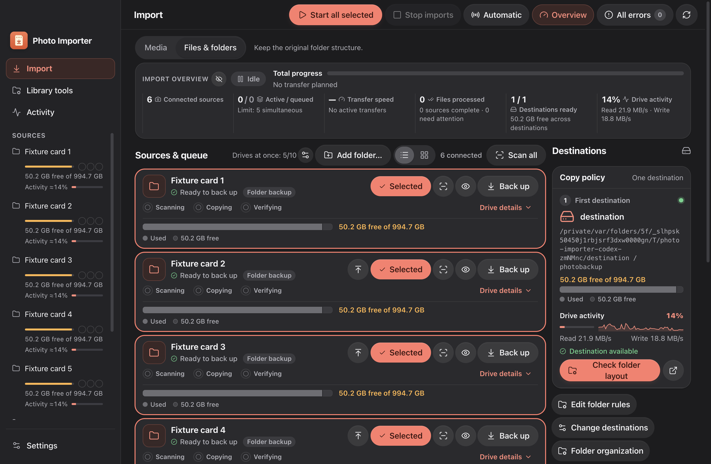
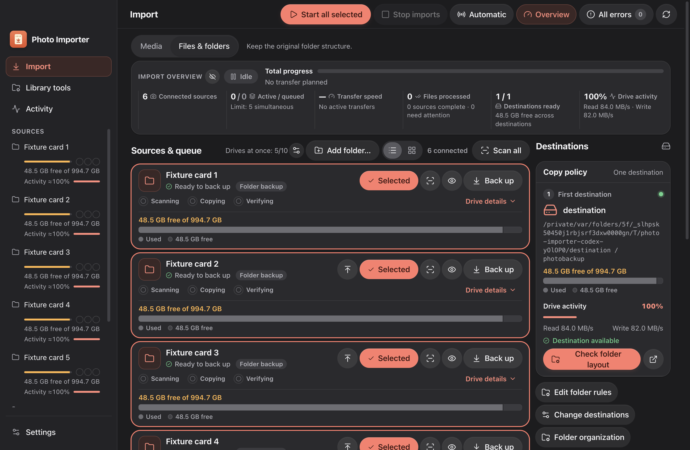
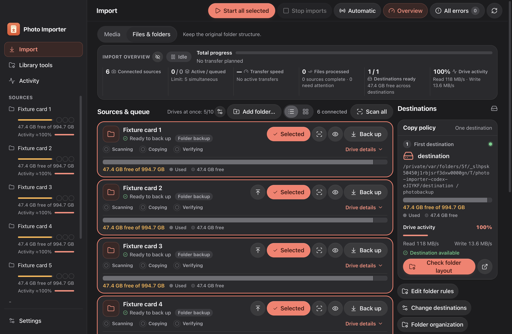
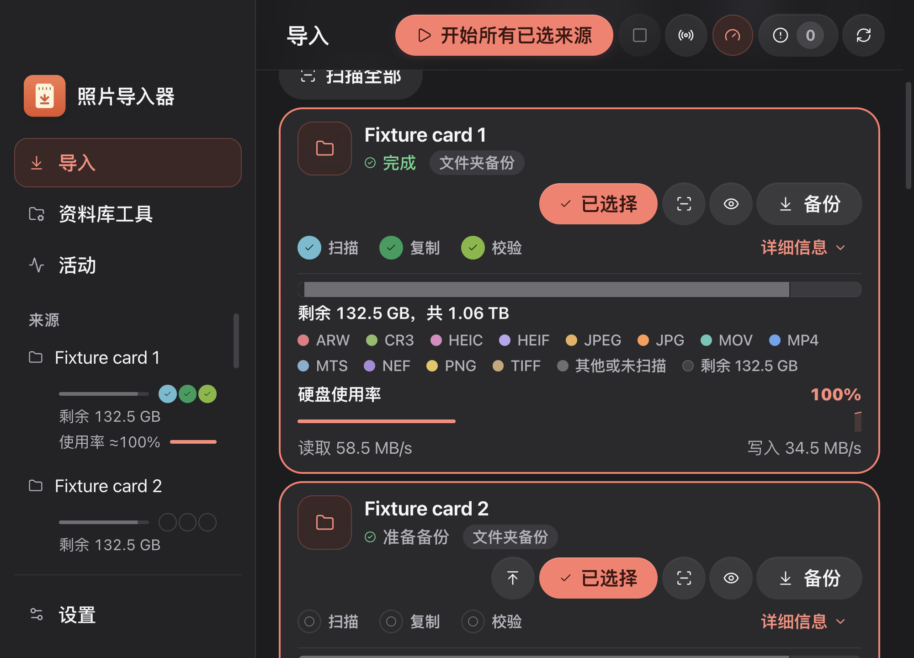

# Integrated UI audit evidence — 2026-10-23

Scope: uncommitted `codex/ui-audit-integration`, based on `7eee02c` plus the captured manual-folder-check work. The primary checkout and installed application were not changed. Reports use UTC timestamps, hence some show 2026-10-24 (the local audit date is October 23).

## Electron fixture runs

| Run | Passed | Skipped | Failed | Duration |
| --- | ---: | ---: | ---: | ---: |
| normal | 56 | 9 | 0 | 247.868 s |
| reduced-motion | 29 | 36 | 0 | 52.745 s |
| final-followups | 8 | 57 | 0 | 52.973 s |

- [Full normal-motion report](normal-report.json): all UI checks, including page/category sweeps, themes, four locales, 100–200% text and three window sizes. Eight transfer/organization checks require a different suite; the ninth skip was the obsolete logging heuristic, replaced and passed in the final follow-up.
- [Reduced-motion report](reduced-motion-report.json): navigation, compact Import, paired destination actions, Activity inventory, cleanup and visual sweeps; other checks were deliberately not selected.
- [Final follow-up report](final-followups-report.json): final build; upward sidebar and Settings highlight order, Activity inventory/metadata, destination Check/Open rows and saved Diagnostics logging. Final heartbeat/stall/originals guards also pass.

The normal run precedes the final job-inventory precedence and Organize/Open grouping refinements. Both are included in the reduced-motion run; the final follow-up also verifies inventory, destination rows and logging. These are fixture results, not evidence of a real hardware-camera transfer.

## Layout and information



Before the subsequent full-width capacity request, at 1440×940 and 125% text the first source card measured 160.33 CSS px high. That historical screenshot uses a horizontal capacity summary. The latest layout gives the capacity bar the full card content width, with its text, legend and activity retained. See the [field-by-field comparison](../ui-information-preservation-2026-10-23.md).

The [clipping](clipped-controls.json), [button width](button-widths.json), [locale](locale-problems.json) and [contrast](contrast.json) findings are empty arrays in the normal sweep. Check folder layout/Organize and Open are grouped on one row, with text wrapping inside the primary action and the Open icon retaining its size. Whole groups can wrap without concealing controls.

## Animation layers and timing

| Surface | Contract checked |
| --- | --- |
| Sidebar highlight | Indicator snapshot 0; branding/device content 1; stable icon/text snapshots 2; upward switching and interruptions |
| Settings categories | Indicator 0; icon/text 2; category navigation contained above panel content |
| Page/chrome | Page 0, sidebar 30, titlebar 40, Toast 60; nested groups remain contained/clipped |
| Reviews, dialogs, metadata, errors | Native top layer and modal nesting; actual pointer handling; cleanup closes All errors before confirmation |
| Timing | Finite interaction durations at most 300 ms; normal/reduced motion, interruption and rapid navigation covered |

The new upward-highlight regression failed before the explicit snapshot ordering fix. Both final highlight regressions pass. [Stress data](stress.json): navigation median 91 ms, maximum 302 ms; All errors opened in 252 ms with 50,000 errors and 60 running jobs. These are fixture observations, not a performance guarantee.

## Build and unit checks

- TypeScript and production build passed. Vite emits its existing large-chunk advisory.
- Final focused renderer/helper regressions: **107 passed, 0 failed** (`/private/tmp/ui-phases-final-regressions.log`). Broader renderer/helper run before the final information refinements: **534 passed, 0 failed** (`/private/tmp/ui-phases-final-ui-unit.log`).
- Initial full suite: **1,686 tests; 1,680 passed, 6 failed**. Five obsolete UI assertions were updated and passed in the focused run. The remaining backend heartbeat threshold failure is described below; the full suite was not rerun and is not reported as green.

### Known baseline limitation

`deleting the recovery files reports at least every 3 s` exceeded its strict 3-second threshold: 3.10 s in the full run and 3.18 s in isolated integration verification. Independent verification on the captured baseline also failed at 3.12 s (71 reports). `core/recovery.ts` and the heartbeat test are byte-identical between baseline and integration. This is a preexisting backend reporting-timing failure, separate from UI animation timing; the threshold was not weakened and core recovery was not changed.

Local logs: `/private/tmp/ui-phases-full-tests.log`, `/private/tmp/ui-phases-heartbeat-isolated.log`, `/private/tmp/ui-phases-baseline-heartbeat.log`. These temporary logs supplement the preserved JSON reports and may not survive system cleanup.

## Parallel independent review

Two new user-visible chats completed independent read-only reviews: [information/layout](parallel-information-review.md) and [animation/layers/timing](parallel-animation-review.md). Both reported **no actionable findings**. Neither edited application code or started Electron.

Coordinator follow-up resolved the reviewers’ evidence limitations:

- The information reviewer omitted the available native-helper environment variable, causing one unrelated native-dependent test to fail. Rerunning `consistent-progress.test.ts` with `IMPORTER_NATIVE_BRIDGE` set to the existing primary-checkout helper passed **180/180**, including that case (`/private/tmp/ui-phases-consistent-final.log`). No helper was installed or rebuilt.
- The animation reviewer received only the two targeted logs, which omit error overlays. The preserved **normal report** separately confirms `errors-on-top-200` and `errors-above-sheets-and-animations` passed. Reduced-motion snapshot-order rows return early and are not counted as proof of animated stacking; the final normal-motion highlight checks provide that evidence.
- Final additional verification: TypeScript, **30/30** information/workspace/stage/motion/misplaced-result tests and **7/7** manual-folder-layout tests passed. `git diff --check` passed.


## Full-width capacity follow-up

Removed the wide-card horizontal split: the capacity track now aligns with both content edges of every source card. Capacity numbers, scanning status, format legend and drive activity remain visible. Production build and the updated Electron geometry/density check passed, together with the three final guards (4 passed, 61 deliberately skipped). [Report](full-width-capacity-report.json), [measurements](full-width-capacity-density.json).



### Inline capacity summary refinement

The capacity track stays full width. Its numbers and complete format legend now share one wrapping row below it, reducing the idle card by one text row at normal widths. No capacity values, category labels or scanning status were removed. At narrow widths the summary wraps naturally rather than using ellipsis. Build and 14/14 information-preservation/stage tests passed.

The actual Electron geometry check passed: the bar aligns with both card content edges and capacity numbers/complete legend share one row (4 checks passed including final guards). [Report](inline-capacity-report.json).



## Responsive capacity matrix and handoff

**144/144 combinations passed, zero missing labels, clipping or overlap findings.** No additional production CSS fix was needed. The dedicated Electron check uses reduced-motion emulation for layout stability, synthetic fixture-only source capacity and a twelve-format inventory (NEF, ARW, CR3, JPG, JPEG, PNG, HEIC, HEIF, MP4, MOV, MTS, TIFF). Import and Activity must include every format; destination cards retain their actual Used/Free legend.

| Dimension | Values |
| --- | --- |
| Content window | 1000×720 (supported minimum), 1120×800, 1440×940 |
| Text size | 100%, 150%, 200% |
| Locale | English, Simplified Chinese, Traditional Chinese, Japanese |
| Surface | Import list, Import grid, Activity Jobs, Settings Storage |

The probe measures actual text-node range rectangles for capacity numbers, every legend label and any logical-size note, tests clipping ancestors within the capacity surface, checks overlap between different labels and requires the track to fill the container. Normal-width single-row alignment remains covered by `import-compact-layout`. A complete legend may wrap over multiple rows at large text sizes. Offscreen cards remain reachable by page scrolling; all legend data stays in the visible document flow. Screenshots scroll the tested capacity panel into view.

Preserved [matrix](capacity-responsive.json) and [Electron report](responsive-capacity-report.json): 4 checks passed (matrix plus three final guards), 62 deliberately unselected, no failures; selected checks took approximately 10 seconds. Build/typecheck, 14/14 information-preservation/stage tests and `git diff --check` passed. The initial 144-case pass was repeated only to improve screenshot framing; no production changes occurred between those two runs.

Reproduce from the integration worktree:

```sh
IMPORTER_NATIVE_BRIDGE=/Users/sager/Documents/GitHub/automatic-photo-importer/build/native/NativeCameraBridge npm run build
IMPORTER_NATIVE_BRIDGE=/Users/sager/Documents/GitHub/automatic-photo-importer/build/native/NativeCameraBridge npm run codex:test -- --ui-only --no-build --only='^import-capacity-responsive$'
node --import tsx --test desktop/tests/information-parity.test.ts desktop/tests/stage-bars.test.ts
```



Other representative captures: [English list](capacity-import-list-en-1000-200.png), [Activity](capacity-activity-en-1000-200.png), [Settings](capacity-settings-zh-Hans-1000-200.png). All eight English/Chinese surface screenshots are preserved in this folder.

Handoff: [/private/tmp/ui-audit-handoff-2026-10-23.md](/private/tmp/ui-audit-handoff-2026-10-23.md). It links durable documents rather than duplicating them, and records branch/worktree ownership, the captured baseline, validation boundaries, completed parallel reviews, known heartbeat limitation and safe integration steps. The handoff skill requires a temporary OS directory; repository evidence and the consolidated audit are the lasting record.
